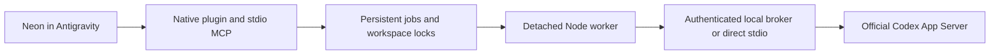

# Codex Worker for Antigravity

Run local OpenAI Codex as a worker for bounded engineering tasks, persistent sessions, and read-only reviews from Google Antigravity. This is an independent Apache-2.0 community port of [openai/codex-plugin-cc](https://github.com/openai/codex-plugin-cc).

## Architecture



Both ports use the official App Server for Codex login, task execution, resume, and native review. This port adds native Antigravity tools, workspace roots, structured handoffs, isolated worktrees, and a bounded optional Stop hook.

## Requirements and installation

Use Antigravity CLI **1.5.17** or the verified **1.5.18**, official Codex CLI **0.172.0** or later, Node.js **20 or later recommended** (runtime floor 18.18), and Git for reviews and worktrees. The verification report records the versions and platforms exercised.

From the source repository:

```text
npm ci
npm run package
agy plugin validate ./dist/plugin --strict --json
agy plugin install ./dist/plugin
agy plugin list --json
```

For a prebuilt ZIP from a trusted distributor, extract it to a new directory. Run `agy plugin validate <directory> --strict --json` and `agy plugin install <directory>` against the directory that contains `plugin.json`. The package includes the stdio server and needs only Node and Codex at runtime. Review the installed components with `agy plugin list --json`, `/skills`, and the interactive `/mcp` view.

Open the target workspace and run `/codex-setup` or call `codex_setup`. Antigravity supplies the workspace over MCP. The built-in host permissions still govern tool calls. Approve the specific tools needed for the task.

## Authentication and models

Check `codex login status` outside Antigravity. If needed, run `codex login` using your authorized account. The official CLI handles ChatGPT, API-key, and configured provider authentication. The plugin reuses that session and reports the authentication mode. It uses `gpt-6.2-sol` with `high` effort when no configuration overrides them. Run setup with explicit `model` and `reasoning_effort` to check availability. Codex model or billing changes require an explicit selection. A server-reported reroute appears in job metadata.

## Configuration

Highest precedence comes first.

1. Explicit tool arguments.
2. Workspace configuration at `<plugin-data>/state/<workspace-key>/config.json`.
3. Global configuration at `<plugin-data>/config.json`.
4. Effective Codex CLI config, including trusted project config.
5. Plugin defaults.

Antigravity supplies the persistent plugin-data directory. For standalone use, `CODEX_PLUGIN_AGY_DATA_DIR` overrides `PLUGIN_DATA`, then the fallback is `~/.gemini/antigravity-codex-plugin-data`. For example, a global plugin config can contain:

```json
{
  "model": "gpt-6.2-sol",
  "reasoningEffort": "high",
  "timeoutSeconds": 600,
  "maxConcurrency": 2,
  "jobRetentionCount": 50
}
```

Change the working directory per tool call or use the host workspace root. Request `sandbox: "workspace-write"` explicitly for authorized edits. The effective Codex configuration sets the sandbox, approval, and network ceiling. `codex_setup` can update the workspace orchestration mode or toggle the workspace Review Gate.

## Orchestration and tools

Invoke `/codex-orchestrator` to choose Assisted, Delegated, Review, or Parallel Worker mode. Delegated mode is the default within this opt-in workflow. Neon plans, scopes tasks, checks diffs and tests, and integrates the result. Codex implements the assigned work. Use Assisted for selective help, Review for independent read-only review, and Parallel Worker for disjoint changes in separate worktrees.

| MCP tool | Purpose |
| --- | --- |
| `codex_setup` | Check environment, login, versions, permissions, and model. Update supported workspace settings. |
| `codex_delegate` | Start a bounded engineering task, optionally detached. |
| `codex_status` | Inspect job state, progress, and poll interval. |
| `codex_result` | Retrieve worker output, telemetry, and optional evidence pages. |
| `codex_cancel` | Interrupt the owning turn and settle the job. |
| `codex_list_jobs` | Page through workspace jobs. |
| `codex_review` | Read-only Git review, including staged, branch, commit, path, and custom scopes. |
| `codex_adversarial_review` | Read-only defensive review with validated findings by severity. |
| `codex_resume` | Continue a workspace-bound persistent thread. |
| `codex_transfer` | Seed a persistent thread with an explicit handoff. |

Examples include `/codex-delegate` with an objective and acceptable files, `/codex-review` for staged changes, and `/codex-result` with a job ID. If another skill uses the same name, select the qualified plugin skill listed by `/skills`.

For Git review scopes, use a branch name for `base` and an explicit commit SHA for `commit`. The plugin rejects relative revision operators such as `HEAD~1` and `HEAD^`.

### Jobs, resume, and worktrees

For long tasks set `background: true`. Save the returned ID, wait the recommended interval, and poll `codex_status`. Fetch `codex_result` when the job settles. Use `include_logs` and `include_diff: "patch"` with their byte cursors for evidence. Smaller `max_bytes` pages such as 8000 help on-demand tool output fit the host's inline limit. Output pagination returns JSON fragments and an `output_cursor` for the next fragment.

Persistent tasks and handoffs include a thread ID and a `codex resume <threadId>` command. Use `codex_resume` in the bound workspace or use the native Codex command for interactive approval. Ephemeral reviews have no CLI resume command.

For isolated writes, use `use_worktree: true` with an authorized `sandbox: "workspace-write"`. Each checkout starts at HEAD. Inspect the reported path, branch, scope drift, and overlapping files before integration. The plugin leaves worktrees and branches for the user to inspect and manage.

### Review Gate

The hook group and workspace setting ship disabled. To opt in, enable the `codex-review-gate` group in a local copy of the plugin's `hooks.json` and install that copy. Then use `codex_setup` with `enable_review_gate: true` in the workspace and begin a new session. Use `disable_review_gate: true` to turn it off for the workspace. The gate reviews detected changes since the last observation, limits continuation attempts, and allows Stop on errors or timeout. `/codex-review` is the explicit alternative.

## Security and troubleshooting

The plugin uses canonical workspace roots, read-only review, fail-closed approvals, bounded redacted output, verified process identity, and authenticated local IPC. `allowed_paths` provides task guidance and a best-effort post-run audit. The official Codex sandbox is the OS access boundary. Worker text and diffs are evidence for the orchestrator to verify.

- **Workspace unavailable** — open a workspace so Antigravity can supply an MCP file root.
- **Model unavailable or effort unsupported** — inspect the setup report and select an available model or effort explicitly.
- **Multiple Codex installations on Windows** — setup checks the version of the binary it will actually launch. An unsupported desktop binary can be superseded by a supported official npm installation. Set `CODEX_BIN` to a specific supported absolute path when needed.
- **Approval required** — use the CLI resume command from the job. The headless plugin declines interactive requests.
- **Interrupted worker** — check the recorded thread and resume if available. Detached survival depends on host and OS shutdown behavior.
- **Broker unavailable** — verify the plugin-data path and permissions. Long Unix socket paths can use the direct stdio fallback.
- **Missing tools** — inspect the installed plugin and the interactive MCP view. A source checkout needs `npm run build` before its launchers are usable.

Antigravity App and IDE behavior, older CLI releases, and live model access depend on the verified environment. No private transcript import or native Executor substitution is provided. Remove the plugin with `agy plugin uninstall codex-plugin-agy`. Inspect and archive retained jobs, worktrees, and branches separately before removing local data.

See [UPSTREAM.md](UPSTREAM.md) for attribution and [README.zh-CN.md](README.zh-CN.md) in the source repository for the Simplified Chinese guide.
