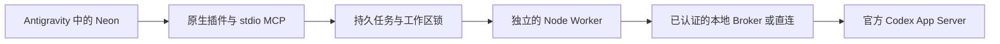

# Antigravity 的 Codex Worker

这个非官方 Apache-2.0 社区移植版让 Gemini 4 Neon 通过 Antigravity 原生插件调用本机 Codex，完成有明确范围的工程任务、持久会话和只读审查。上游项目为 [openai/codex-plugin-cc](https://github.com/openai/codex-plugin-cc)。

## 架构



两个项目均通过官方 App Server 复用登录、运行任务、续接会话及调用原生审查。本移植版增加了 Antigravity 原生工具、工作区根目录校验、显式交接、隔离 worktree 和可选的有界 Stop 审查。

## 版本与安装

主验证环境为 Antigravity CLI **1.5.17** 和 Codex CLI **0.172.0**。建议使用 Node.js **20 或更高版本**，运行时最低为 18.18。审查和 worktree 还需要 Git。实际验证的平台与版本见项目验证报告。

从源码构建并安装：

```text
npm ci
npm run package
agy plugin validate ./dist/plugin --strict --json
agy plugin install ./dist/plugin
agy plugin list --json
```

安装预构建版本时，将可信来源的 ZIP 解压到新目录。对含有 `plugin.json` 的目录运行 `agy plugin validate <目录> --strict --json` 和 `agy plugin install <目录>`。运行时只需要 Node 和 Codex。使用 `agy plugin list --json`、`/skills` 和交互式 `/mcp` 检查组件。

打开目标工作区并运行 `/codex-setup` 或 `codex_setup`。Antigravity 通过 MCP 提供工作区根目录。按任务需要授权具体工具。

## 登录、模型与配置

在终端运行 `codex login status`。需要登录时使用官方 `codex login`。插件复用官方 CLI 的 ChatGPT、API Key 或自定义 Provider 登录态。缺少其他配置时默认模型为 `gpt-6.2-sol`，推理等级为 `high`。可在 `codex_setup` 指定模型和推理等级以检查权限。只有显式选择才会更改请求模型。如 Codex 报告重路由，结果会显示实际模型。

配置优先级从高到低如下。

1. 工具调用显式参数。
2. 工作区配置 `<插件数据>/state/<工作区标识>/config.json`。
3. 全局插件配置 `<插件数据>/config.json`。
4. Codex CLI 的有效配置，包含受信任的项目配置。
5. 插件安全默认值。

独立运行时，数据目录依次采用 `CODEX_PLUGIN_AGY_DATA_DIR`、`PLUGIN_DATA` 和 `~/.gemini/antigravity-codex-plugin-data`。全局配置示例：

```json
{
  "model": "gpt-6.2-sol",
  "reasoningEffort": "high",
  "timeoutSeconds": 600,
  "maxConcurrency": 2,
  "jobRetentionCount": 50
}
```

可在调用时选择工作目录。只有用户授权修改时才显式请求 `workspace-write`。Codex 的有效配置限制沙箱、审批和网络权限。通过 `codex_setup` 可更新工作区的编排模式和 Review Gate 开关。

## 编排模式和工具

按需调用 `/codex-orchestrator`。Assisted 模式由 Neon 处理常规任务，必要时使用 Codex。Delegated 模式在启用编排后默认使用，由 Neon 规划和验收，Codex 实现有明确范围的任务。Review 模式用于独立只读审查。Parallel Worker 模式让写入任务使用独立 worktree。Neon 负责检查工作区实际差异、运行验证并集成。

| MCP 工具 | 用途 |
| --- | --- |
| `codex_setup` | 检查环境、登录、模型、权限及 Broker。 |
| `codex_delegate` | 委派有明确范围的前台或后台任务。 |
| `codex_status` | 查询进度、状态及建议轮询间隔。 |
| `codex_result` | 获取结果与分页证据。 |
| `codex_cancel` | 中断执行中的任务。 |
| `codex_list_jobs` | 分页查询工作区任务。 |
| `codex_review` | 只读审查未提交、暂存、分支、提交或路径范围。 |
| `codex_adversarial_review` | 按严重程度返回经校验的防御性审查结论。 |
| `codex_resume` | 续接绑定到当前工作区的线程。 |
| `codex_transfer` | 将显式提供的结构化上下文交接给持久线程。 |

例如通过 `/codex-delegate` 描述目标、范围和验收标准，通过 `/codex-review` 请求审查暂存变更，或使用 `/codex-result` 传入任务 ID。在 `/skills` 中可找到插件命名空间下的技能。

### 后台任务、续接和并行写入

耗时任务使用 `background: true`。记录任务 ID，按 `codex_status` 建议的间隔轮询，结束后调用 `codex_result`。日志和补丁支持字节游标，较小的 `max_bytes` 有助于主机内联显示。

持久任务和交接会返回线程 ID 及 `codex resume <threadId>`。普通续接可用 `codex_resume`，需要审批时请在官方命令行内续接。临时审查线程不支持恢复。

对授权的并行修改使用 `use_worktree: true` 和 `sandbox: "workspace-write"`。每个 worktree 从 HEAD 开始。主工作区的未提交修改会被保留。集成前请检查返回的分支、路径、冲突和超出范围的文件。

### Review Gate

默认关闭。启用时先在本地插件副本的 `hooks.json` 开启 `codex-review-gate` 并安装副本，然后在工作区调用 `codex_setup`，设置 `enable_review_gate: true` 并开始新会话。使用 `disable_review_gate: true` 关闭工作区设置。审查同一轮次的次数有限，异常或超时时允许停止。也可通过 `/codex-review` 显式审查。

## 安全、故障排查与卸载

插件校验标准化工作区路径，使用只读审查、非交互拒绝审批、认证 IPC、进程身份验证以及有界脱敏输出。`allowed_paths` 用于任务范围提示和尽力而为的事后审计，操作系统访问由 Codex 沙箱控制。检查实际变更和测试结果后再采纳 Worker 结论。

- 工作区缺失时打开项目后重新调用工具。
- 模型或推理等级不可用时通过 setup 检查权限，再显式选择其他配置。
- 需要审批时使用结果中的原生续接命令。
- 任务中断后检查持久线程是否可续接。后台进程能否跨主机退出存活取决于操作系统和主机行为。
- Broker 遇到 Unix 套接字路径过长时可直连。
- 组件未发现时检查安装清单与交互式 `/mcp`，源码启动器需要先执行构建。

旧版 CLI、Antigravity App 和 IDE 的行为以实际验证为准。本插件依赖公开接口和显式交接。使用 `agy plugin uninstall codex-plugin-agy` 卸载插件。保留的任务、worktree 和分支可在核验后单独归档或清理。

上游版本和许可证见 [UPSTREAM.md](UPSTREAM.md)。
