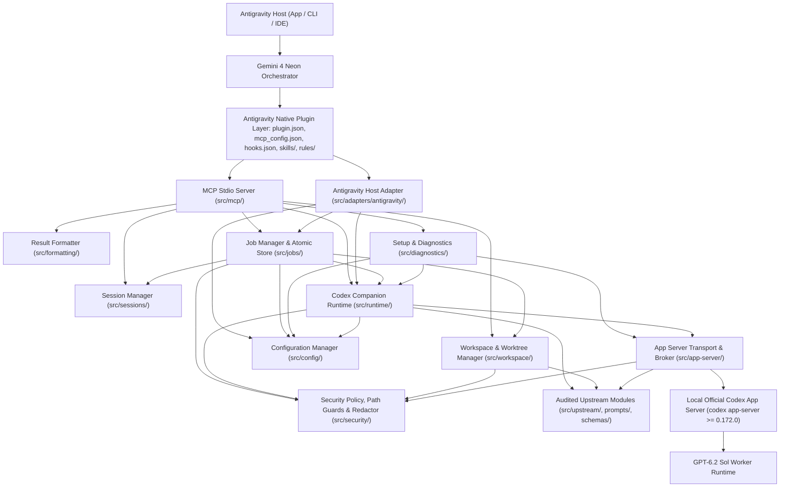
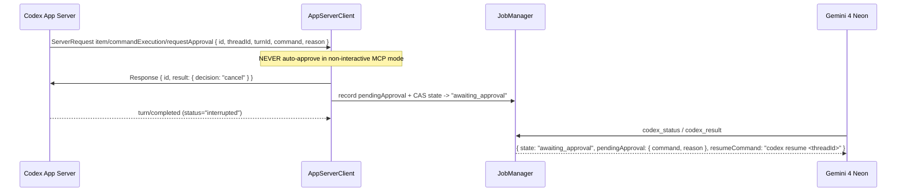

# System Architecture — `codex-plugin-agy`

This document defines the authoritative software architecture, module boundaries, protocol contracts, job state machine, MCP tool interface, Antigravity Native Plugin layout, Neon orchestration protocol, and cross-platform packaging design for `codex-plugin-agy`.

---

## 1. Architectural Principles & Non-Goals

1. **Upstream-First Reuse**: Reuse audited, host-agnostic logic from `openai/codex-plugin-cc@db52e28` (`src/upstream/`, `prompts/`, `schemas/`) and isolate all Antigravity-specific adapters outside the core runtime.
2. **Host Independence**: Core runtime (`src/app-server/`, `src/runtime/`, `src/jobs/`, `src/sessions/`, `src/workspace/`, `src/security/`, `src/config/`, `src/formatting/`, `src/diagnostics/`) MUST have **zero imports** from `@modelcontextprotocol/sdk` or `src/adapters/antigravity/`.
3. **Full Agent Runtime Integration**: Communicate with local official `codex app-server` over newline-delimited JSON-RPC; never reimplement an OpenAI REST API wrapper or claim to alter Antigravity's native executor model.
4. **Security by Default & Monotonic Policy**: Never weaken user Codex security settings, never silently fall back to another model or paid auth method, never auto-approve sensitive prompts, and never fabricate worker results.
5. **Zero-`node_modules` Runtime Distribution**: Author in TypeScript/ESM against `@modelcontextprotocol/sdk` (`^1.32.2`) + `zod`, and bundle distributable runtime entrypoints with `esbuild` so installed Antigravity plugins run with `node` alone and zero post-install `npm install`.

---

## 2. Layered System Architecture & Dependency DAG



### Strict Dependency Boundary Rules (Enforced in Code Reviews & Tests)

| Layer | Allowed Imports | Forbidden Imports |
| --- | --- | --- |
| `src/upstream/*` | Node.js built-ins + sibling `src/upstream/*` | Any `src/*` module outside `src/upstream/` |
| `src/security/*` | Node.js built-ins, `src/upstream/*` | `src/mcp/*`, `src/adapters/*`, `src/runtime/*`, `src/jobs/*` |
| `src/config/*` | Node.js built-ins, `src/security/*`, `src/upstream/*` | `src/mcp/*`, `src/adapters/*`, `src/jobs/*` |
| `src/app-server/*` | Node.js built-ins, `src/security/*`, `src/upstream/*`, `.generated/app-server-types/*` | `src/mcp/*`, `src/adapters/*`, `src/jobs/*`, `src/runtime/*` |
| `src/runtime/*` | `src/app-server/*`, `src/security/*`, `src/config/*`, `src/upstream/*` | `src/mcp/*`, `src/adapters/*`, `src/jobs/*` |
| `src/workspace/*` | `src/security/*`, `src/config/*`, `src/upstream/*` | `src/mcp/*`, `src/adapters/*`, `src/runtime/*` |
| `src/sessions/*` | `src/security/*`, `src/config/*`, `src/upstream/*`, `src/runtime/*` | `src/mcp/*`, `src/adapters/*` |
| `src/jobs/*` | `src/runtime/*`, `src/sessions/*`, `src/workspace/*`, `src/security/*`, `src/config/*`, `src/upstream/*` | `src/mcp/*`, `src/adapters/*` |
| `src/formatting/*` | `src/security/*`, `src/jobs/*` (types), `src/runtime/*` (types) | `src/mcp/*`, `src/adapters/*` |
| `src/diagnostics/*` | `src/runtime/*`, `src/app-server/*`, `src/config/*`, `src/security/*`, `src/workspace/*` | `src/mcp/*`, `src/adapters/*` |
| `src/adapters/antigravity/*` | Core modules (`src/config`, `src/jobs`, `src/runtime`, `src/security`, `src/diagnostics`) | `src/mcp/*` |
| `src/mcp/*` | `@modelcontextprotocol/sdk`, `zod`, and all core modules | Direct `codex` process spawning (must go through `src/runtime/` or `src/jobs/`) |

---

## 3. Repository Structure & Distributable Package Layout

### 3.1 Source Repository Layout (`codex-plugin-agy/`)

```text
codex-plugin-agy/
├── plugin.json                        # Native Antigravity manifest (Schema v1)
├── mcp_config.json                    # Local stdio MCP server definition
├── hooks.json                         # Antigravity lifecycle hooks (Review Gate OFF by default)
├── package.json                       # ESM project, devDependencies, build/test/package scripts
├── package-lock.json
├── tsconfig.json                      # Strict TypeScript config for src/
├── tsconfig.upstream.json             # checkJs validation for src/upstream/
├── AGENTS.md                          # Contributor & coding-agent guide (ignored by Antigravity plugin loader)
├── README.md                          # English documentation
├── README.zh-CN.md                    # Simplified Chinese documentation
├── LICENSE                            # Apache-2.0
├── NOTICE                             # Upstream OpenAI + community port attribution
├── UPSTREAM.md                        # Upstream commit SHA, provenance, sync guide
├── CHANGELOG.md
├── SECURITY.md
├── assets/
│   └── logo.svg                       # 1:1 square high-contrast SVG icon (>= 128x128, ~10% margin)
├── prompts/
│   ├── adversarial-review.md          # Reused from codex-plugin-cc
│   └── stop-review-gate.md            # Adapted for Antigravity / Neon
├── schemas/
│   └── review-output.schema.json      # Reused from codex-plugin-cc
├── skills/                            # Exposed as /<skill-name> in Antigravity
│   ├── codex-setup/SKILL.md
│   ├── codex-delegate/SKILL.md
│   ├── codex-review/SKILL.md
│   ├── codex-adversarial-review/SKILL.md
│   ├── codex-status/SKILL.md
│   ├── codex-result/SKILL.md
│   ├── codex-cancel/SKILL.md
│   ├── codex-resume/SKILL.md
│   ├── codex-transfer/SKILL.md
│   └── codex-orchestrator/
│       ├── SKILL.md
│       └── references/
│           └── prompt-contracts.md    # Adapted XML prompt contracts for GPT-6.2 Sol
├── rules/
│   ├── AGENTS.md                      # Lightweight always-on safety & evidence boundaries (non-takeover)
│   └── codex-delegated-mode.md        # Opt-in rule (trigger: manual) for Delegated Mode
├── scripts/
│   ├── mcp-server.mjs                 # Launcher -> dist/runtime/mcp-server.mjs (replaced by bundle in dist/plugin/)
│   ├── app-server-broker.mjs          # Launcher -> dist/runtime/app-server-broker.mjs
│   ├── task-worker.mjs                # Launcher -> dist/runtime/task-worker.mjs
│   ├── hooks.mjs                      # Launcher -> dist/runtime/hooks.mjs
│   ├── build.mjs                      # esbuild bundling + tsc verification
│   └── package.mjs                    # Builds zero-node_modules dist/plugin/ & release archives
├── src/
│   ├── upstream/                      # Reused/minimally-adapted ESM modules from codex-plugin-cc
│   │   ├── args.mjs
│   │   ├── fs.mjs
│   │   ├── git.mjs
│   │   ├── prompts.mjs
│   │   └── workspace.mjs
│   ├── security/
│   ├── config/
│   ├── app-server/
│   ├── runtime/
│   ├── workspace/
│   ├── sessions/
│   ├── jobs/
│   ├── formatting/
│   ├── diagnostics/
│   ├── adapters/
│   │   └── antigravity/
│   └── mcp/
├── docs/
│   ├── upstream-audit.md
│   ├── porting-matrix.md
│   ├── architecture.md
│   ├── security-model.md
│   └── implementation-plan.md
├── tests/
│   ├── fixtures/
│   │   └── mock-app-server.mjs
│   ├── unit/
│   ├── integration/
│   ├── mcp/
│   ├── security/
│   └── e2e/
└── .github/
    └── workflows/
        └── ci.yml
```

> **Why no `agents/` directory?** Per `SPEC.md` lines 166 & 682, subdirectories are created only when functionally necessary. Because Neon invokes MCP tools directly (`codex_delegate`, `codex_review`, etc.), a Claude-style `codex-rescue` forwarding subagent would only add redundant LLM latency and prompt distortion.

### 3.2 Self-Contained Distributable Package (`dist/plugin/`)
`npm run package` outputs `dist/plugin/` (and `.tar.gz`/`.zip` release archives under `dist/releases/`) containing **only** runtime files:
- `plugin.json`, `mcp_config.json`, `hooks.json`, `README.md`, `LICENSE`, `NOTICE`, `UPSTREAM.md`
- `assets/`, `prompts/`, `schemas/`, `skills/`, `rules/`
- `scripts/mcp-server.mjs`, `scripts/app-server-broker.mjs`, `scripts/task-worker.mjs`, `scripts/hooks.mjs` — each bundled as a self-contained ESM file via `esbuild` (`platform: "node"`, `format: "esm"`, `target: "node20"`, `bundle: true`) with **zero `node_modules` dependency**.
- Excludes root `AGENTS.md`, `src/`, `tests/`, `docs/`, `node_modules/`, `.github/`.
- Both the source repo root (`.`) and `dist/plugin/` MUST pass `agy plugin validate`.

---

## 4. Core Flows (Sequence Diagrams)

### 4.1 Background Delegation, Polling, Result Retrieval & Cancellation

```mermaid
sequenceDiagram
    participant Neon as Gemini 4 Neon
    participant MCP as MCP Server (stdio)
    participant JM as JobManager & Store
    participant Worker as Detached task-worker.mjs
    participant Broker as Authenticated Broker / Direct AppServer
    participant Codex as Codex App Server (GPT-6.2 Sol)

    Neon->>MCP: codex_delegate(task, cwd, background=true, sandbox="workspace-write")
    MCP->>JM: validate policy + workspace lock + model/list check
    JM->>JM: atomic write jobs/<jobId>.json (state="queued") & state.json
    JM->>Worker: spawn detached node scripts/task-worker.mjs --cwd ... --job-id ...
    MCP-->>Neon: { jobId, state: "queued", recommendedPollIntervalMs: 5000, nextActions }

    Worker->>JM: CAS state "queued" -> "starting" (record verified ProcessIdentity)
    Worker->>Broker: connect + broker/auth + initialize + thread/start(ephemeral=false)
    Broker->>Codex: thread/start -> { thread.id, model, sandbox, approvalPolicy }
    Worker->>JM: update threadId, effectiveModel; CAS "starting" -> "running"
    Worker->>Broker: turn/start(input, model, effort, sandboxPolicy)
    Broker->>Codex: turn/start -> { turn.id }
    Codex-->>Worker: item/started, item/completed, thread/tokenUsage/updated, turn/diff/updated
    Worker->>JM: append redacted log events + update phase & lastProgressAt

    Neon->>MCP: codex_status(job_id)
    MCP->>JM: read state + verify worker liveness
    MCP-->>Neon: { state: "running", threadId, turnId, latestProgress, recommendedPollIntervalMs }

    alt Normal Completion
        Codex-->>Worker: turn/completed (status="completed")
        Worker->>JM: CAS "running" -> "completed" + write redacted structured result
        Neon->>MCP: codex_result(job_id)
        MCP-->>Neon: { pluginMeta, workerOutput, pagination }
    else User / Neon Cancellation
        Neon->>MCP: codex_cancel(job_id)
        MCP->>JM: CAS "running" -> "cancelling" + write cancel marker
        MCP->>Broker: turn/interrupt(threadId, turnId) (if broker-owned)
        MCP->>Worker: verify ProcessIdentity -> SIGTERM (worker interrupts direct client & exits)
        JM->>JM: grace wait -> verified process-tree kill if still alive -> CAS "cancelling" -> "cancelled"
        MCP-->>Neon: { jobId, state: "cancelled", turnInterrupted }
    end
```

### 4.2 Approval Request Fail-Closed Handling



---

## 5. Module-by-Module Design Contracts

### 5.1 Configuration Manager (`src/config/`)
- **Storage Locations**:
  - Global plugin config: `<pluginDataRoot>/config.json`
  - Workspace plugin config: `<pluginDataRoot>/state/<slug>-<sha256_16>/config.json`
  - `<pluginDataRoot>` resolution order: `process.env.PLUGIN_DATA` -> `path.join(os.homedir(), ".gemini", "antigravity-codex-plugin-data")` (created `0o700`, never world-shared `/tmp`).
- **Deterministic Precedence Order (Highest -> Lowest)**:
  1. Explicit MCP tool invocation arguments (e.g., `model`, `reasoning_effort`, `sandbox`, `timeout_seconds`).
  2. Workspace plugin config (`<workspaceStateDir>/config.json`).
  3. Global plugin config (`<pluginDataRoot>/config.json`).
  4. Effective Codex CLI config returned by `config/read({ includeLayers: true, cwd })` (covering trusted `.codex/config.toml` -> `~/.codex/config.toml` -> system/enterprise layers).
  5. Plugin safe defaults:
     - `model`: `"gpt-6.2-sol"`
     - `reasoningEffort`: `"high"`
     - `sandbox`: `"read-only"` (for analysis/review); `"workspace-write"` ONLY when explicitly requested on `codex_delegate` or `codex_resume`.
     - `approvalPolicy`: `"never"` ONLY when user's Codex config does not mandate a stricter policy (see Monotonic Security Rule below).
     - `timeoutSeconds`: `600` (min `10`, max `3600`).
     - `maxConcurrency`: `2` (min `1`, max `8`).
     - `jobRetentionCount`: `50` (min `10`, max `500`).
     - `orchestrationMode`: `"delegated"` (active only when user enables orchestration or invokes `/codex-orchestrator` — never hijacks Antigravity by default!).
     - `reviewGate`: `{ enabled: false, maxRunsPerTurn: 2, timeoutSeconds: 120 }`.
- **Security Monotonicity Rule**:
  - Plugin config or tool args may **tighten** security (e.g., `workspace-write` -> `read-only`, `never` -> `on-request`), NEVER **weaken** a stricter policy configured by the user in Codex (`config.sandbox_mode`, `config.approval_policy`, or `config.sandbox_workspace_write.network_access`).
  - `danger-full-access` is **always rejected** at schema and policy layers, even if explicitly passed.

### 5.2 App Server Transport & Broker (`src/app-server/`)
- **Cross-Platform Binary Resolver (`src/app-server/binary-resolver.ts`)**:
  - Resolves `codex` without `shell: true` (eliminating Node 24 `DEP0190` and shell injection):
    1. Respect explicit `CODEX_BIN` env override only if it resolves to an existing file (validated, no shell metacharacters).
    2. On POSIX: locate `codex` on `PATH` and spawn directly with `shell: false`.
    3. On Windows: scan `PATH` for `codex.exe` first; if only npm's `codex.cmd` exists, inspect the shim for the standard `@openai/codex/bin/codex.js` target and invoke `[process.execPath, codexJsPath, ...args]` with `shell: false`! For non-standard `.cmd` shims (e.g., test fixtures), spawn `cmd.exe` with `["/d", "/s", "/c", shimPath, ...args]` ONLY for fixed, validated internal argv (`["--version"]`, `["app-server"]`, `["app-server", "--help"]`) — never passing user prompt text in CLI args.
- **JSONL Transport (`src/app-server/client.ts`)**:
  - Enforces max single JSONL line length (`16 MiB`) and max buffered `stderr` (`512 KiB` ring buffer) to prevent OOM DoS.
  - Sends `clientInfo: { name: "codex-plugin-agy", title: "Codex Plugin for Antigravity", version }`, `capabilities: { experimentalApi: false, requestAttestation: false, optOutNotificationMethods: ["item/agentMessage/delta", "item/reasoning/summaryTextDelta", "item/reasoning/summaryPartAdded", "item/reasoning/textDelta"] }`.
  - Handles all `ServerRequest` methods via an injected `onServerRequest` handler defaulting to fail-closed approval denial (`"cancel"` for command/file approvals, empty `{ permissions: {}, scope: "turn" }` for permission elevation, JSON-RPC `-32601` for unknown methods).
- **Hardened Broker (`src/app-server/broker-server.ts`, `broker-lifecycle.ts`, `broker-endpoint.ts`)**:
  - Unix socket path: `<pluginDataRoot>/run/<workspaceHash>/<sessionToken>.sock` inside a `0o700` dir, `chmod 0o600` on socket file.
  - Windows pipe path: `\\.\pipe\codex-agy-<16-hex-random>`.
  - Generates a 32-byte random hex `authToken` persisted in `broker.json` (`0o600`). Every client connection MUST send `{ id, method: "broker/auth", params: { token } }` as its first message before any RPC is forwarded; unauthenticated sockets are closed immediately.
  - Exposes `broker/health` (returns `{ ok: true, pid, startedAtMs, uptimeMs, busy, appServerAlive }`) and `broker/shutdown`.
  - Enforces configurable idle TTL (default `15 minutes`) so orphaned brokers self-terminate cleanly even though Antigravity has no `SessionEnd` hook.
  - Retains upstream's single-flight lock (`BROKER_BUSY_RPC_CODE = -32001`) with automatic **direct `codex app-server` fallback** for concurrent workers, ensuring parallel workers never serialize behind one broker socket.

### 5.3 Codex Companion Runtime (`src/runtime/`)
- **Pre-Flight Model & Effort Verification (`src/runtime/model-validator.ts`)**:
  - Queries `model/list({ includeHidden: true })` (paginating through `nextCursor` if non-null).
  - If `model/list` returns models:
    - Exact match on `entry.id === requestedModel || entry.model === requestedModel`. If missing -> throw typed `MODEL_UNAVAILABLE` error listing available non-hidden model IDs and remediation steps. **NO silent fallback.**
    - If `requestedEffort` is provided and `entry.supportedReasoningEfforts.length > 0`, verify `requestedEffort` is in `entry.supportedReasoningEfforts.map(e => e.reasoningEffort)`. If missing -> throw typed `EFFORT_UNSUPPORTED` error listing supported efforts for that model.
  - If `model/list` is unsupported (`-32601`) or empty on a custom third-party provider (`requiresOpenaiAuth === false`), record `modelValidation: "unverified_custom_provider"` in diagnostics and proceed transparently without silent model substitution.
- **Turn Execution & Event Capture (`src/runtime/codex-runtime.ts`)**:
  - `serviceName: "antigravity_codex_plugin"`.
  - Preserves upstream's `captureTurn` + `scheduleInferredCompletion` (250ms drain after `final_answer` once `pendingCollaborations` and `activeSubagentTurns` are empty).
  - Captures additionally from Codex `0.172.0` notifications & responses:
    - `effectiveModel` from `ThreadStartResponse.model` / `ThreadResumeResponse.model` + `model/rerouted` notifications (recording `rerouted: { fromModel, toModel, reason }` if rerouted).
    - `tokenUsage` from `thread/tokenUsage/updated` (`total`, `last`, `modelContextWindow`; `null` if server did not emit it — never fabricated!).
    - `turnDiff` from `turn/diff/updated` (bounded).
    - `commandsExecuted` from `item/completed` where `item.type === "commandExecution"` (`command`, `exitCode`, `status`, `durationMs`, redacted truncated output) plus heuristic `testsExecuted` classification reusing upstream's verification command pattern.
    - `fileChanges` from `item/completed` where `item.type === "fileChange"`.
    - `approvalEvents` from fail-closed `ServerRequest` handler.
- **Review Engine (`src/runtime/review.ts`)**:
  - Always forces `sandbox: "read-only"`.
  - **Normal Review (`codex_review`)**:
    - Maps targets directly to native `review/start` (`delivery: "inline"`):
      - `scope: "uncommitted"` -> `{ type: "uncommittedChanges" }`
      - `scope: "branch"` / `base` -> `{ type: "baseBranch", branch }`
      - `commit` (SHA) -> `{ type: "commit", sha, title }`
      - `instructions` (custom review instructions without staged/path filter) -> `{ type: "custom", instructions }`
    - When `scope: "staged"` or `paths` filter is specified (which native `review/start` `ReviewTarget` does not natively parameterize), collects the exact scoped diff via `src/upstream/git.mjs` and runs a read-only `turn/start` review turn with strict grounding instructions.
  - **Adversarial Review (`codex_adversarial_review`)**:
    - Collects scoped repository context via `src/upstream/git.mjs` (inline diff if `<= 2` files & `<= 256 KiB`, else lightweight summary + read-only git inspection guidance) for uncommitted, staged, branch, commit, or path-filtered scopes.
    - Renders `prompts/adversarial-review.md` and runs read-only `turn/start` with `outputSchema: schemas/review-output.schema.json`.
    - Validates and sorts findings by severity (`critical > high > medium > low`).
- **Structured Session Transfer (`src/runtime/transfer.ts`)**:
  - Accepts Neon's structured handoff package (`objective`, `summary`, `architecture_decisions`, `constraints`, `relevant_files`, `previous_attempts`, `unresolved_issues`, `acceptance_criteria`, `cwd`, `model`, `reasoning_effort`).
  - Validates `cwd` and `relevant_files` against workspace boundaries.
  - Calls `thread/start({ cwd, model, sandbox: "read-only", approvalPolicy, serviceName: "antigravity_codex_plugin", ephemeral: false })` + `thread/name/set({ threadId, name: "Antigravity Handoff: <short objective>" })` + initial read-only `turn/start` asking Codex to acknowledge the handoff context, confirm key constraints/open questions concisely, and wait for follow-up.
  - Registers thread binding in `SessionManager` and returns `{ threadId, resumeCommand: "codex resume <threadId>", acknowledgement, workspaceRoot }`.

### 5.4 Job Manager, 10-State FSM & Persistence (`src/jobs/`)

#### 5.4.1 Finite State Machine (10 States)

| State | Terminal? | Description | Allowed Next States |
| --- | --- | --- | --- |
| `queued` | No | Job persisted on disk, worker spawned or awaiting slot | `starting`, `cancelling`, `failed`, `interrupted` |
| `starting` | No | Worker alive, connecting to App Server / validating model / creating thread | `running`, `awaiting_approval`, `cancelling`, `failed`, `timed_out`, `interrupted` |
| `running` | No | Codex turn actively executing (`turnId` assigned) | `awaiting_approval`, `completed`, `failed`, `cancelling`, `timed_out`, `interrupted` |
| `awaiting_approval` | Yes (for turn; resumable) | Codex requested approval that MCP mode cannot auto-approve; turn halted cleanly | `running` (via `codex_resume` creating new job on same thread), `cancelled` |
| `cancelling` | No | Cancel requested; `turn/interrupt` and graceful worker shutdown in progress | `cancelled`, `completed` (if finished before interrupt landed), `failed`, `interrupted` |
| `completed` | Yes | Turn completed cleanly (`turn.status === "completed"`) | *(terminal)* |
| `failed` | Yes | Turn or runtime failed with error | *(terminal)* |
| `cancelled` | Yes | Cancelled cleanly via `codex_cancel` | *(terminal)* |
| `timed_out` | Yes | Exceeded `timeout_seconds`; `turn/interrupt` + worker shutdown executed | *(terminal)* |
| `interrupted` | Yes | Worker process died unexpectedly or host restarted mid-job (crash recovery) | *(terminal; thread remains resumable if `threadId` was recorded)* |

#### 5.4.2 Atomic Persistence & Locking (`src/jobs/state-store.ts`)
- Workspace lockfile: `<workspaceStateDir>/.state.lock` acquired via `fs.openSync(lockPath, "wx")` with bounded backoff retry (5s timeout) and stale-lock detection (mtime > 30s + dead owner PID).
- Atomic writes: write to `<target>.tmp.<pid>.<rand>`, `fs.fsyncSync(fd)`, `fs.closeSync(fd)`, `fs.renameSync(tmp, target)` (with Windows `EPERM`/`EBUSY` exponential backoff retry up to 5 attempts).
- **Write-before-spawn invariant**: `jobs/<jobId>.json` (state `queued`) and `state.json` index entry are committed atomically *before* spawning `scripts/task-worker.mjs`, fixing `AUD-02`.
- **Compare-And-Set (CAS) updates**: Every state transition passes `expectedStates: JobState[]`. A terminal state (`completed`, `failed`, `cancelled`, `timed_out`, `interrupted`) can NEVER be overwritten by a late racing writer, eliminating the cancel-vs-complete race (`AUD-07`).

#### 5.4.3 Verified Process Identity & Crash Recovery (`src/jobs/process-identity.ts`)
- Stored on every running job and broker:
  ```ts
  export interface ProcessIdentity {
    pid: number;
    startedAtMs: number;
    markerToken: string;   // passed via env CODEX_AGY_WORKER_TOKEN or argv --token
    executable: string;    // normalized process.execPath basename ("node" / "node.exe")
  }
  ```
- Before sending `SIGTERM` / `taskkill` OR during stale-job liveness checks:
  1. Check `process.kill(pid, 0)` (cross-platform existence check).
  2. Inspect OS process metadata (`ps -p <pid> -o lstart=,command=` on POSIX; `powershell` / `wmic` / CIM `Win32_Process` `ProcessId,CreationDate,CommandLine` with `shell: false` on Windows) and verify `markerToken` matches (or creation timestamp is within 5s tolerance of `startedAtMs` AND command line contains `codex-plugin-agy` worker/broker script).
  3. Never kill a PID whose identity does not match! If PID is dead or recycled -> mark job `interrupted` (`interruptedReason: "worker_process_exited_unexpectedly"`), release any workspace write lock, and preserve `threadId` + `codex resume <threadId>` for recovery.
- **Cross-host restart honesty**: Detached `task-worker.mjs` processes may survive an Antigravity restart on POSIX/Windows, OR the OS/host may kill child process groups on exit. On startup / `codex_status` / `codex_list_jobs`, the plugin reconciles persisted jobs against live verified worker identities: still-alive workers remain `running`; dead workers are accurately marked `interrupted` with resume instructions (`SPEC.md` lines 477–479).

#### 5.4.4 Reliable Cancellation & Timeout Enforcement
- **Per-job timeout**: Inside `task-worker.mjs`, a monotonic timer fires at `timeout_seconds * 1000`, transitions state `running -> timed_out` (after sending `turn/interrupt` to the live client and awaiting up to 5s for `turn/completed`), then closes the client and exits.
- **Cancellation (`codex_cancel`)**:
  1. CAS `queued | starting | running -> cancelling` and write `<workspaceStateDir>/jobs/<jobId>.cancel` sentinel file.
  2. If `threadId` & `turnId` exist and job uses the shared broker -> send `turn/interrupt` via authenticated broker.
  3. Send verified-PID `SIGTERM` (POSIX) or trigger worker's cancel-file watcher (polls every 250ms, works identically on Windows where `SIGTERM` kills immediately without firing JS signal handlers!).
  4. Worker detects cancel sentinel / `SIGTERM`, sends `turn/interrupt` on its **own live App Server client** (covering direct-client fallback too!), waits up to 3s for clean turn termination, closes client, and CAS-transitions `cancelling -> cancelled`.
  5. If worker does not exit within 5s grace period -> `codex_cancel` performs verified-PID `terminateProcessTree` and commits `cancelled`.

### 5.5 Session Manager (`src/sessions/`)
- Persists `<workspaceStateDir>/sessions.json` (atomic) mapping `threadId -> ThreadBinding`:
  ```ts
  export interface ThreadBinding {
    threadId: string;
    workspaceRoot: string;       // canonical realpath
    effectiveCwd: string;        // workspaceRoot or worktreePath
    worktreePath: string | null;
    sandbox: "read-only" | "workspace-write";
    approvalPolicy: string;
    model: string;
    reasoningEffort: string;
    ephemeral: boolean;
    createdAt: string;
    lastJobId: string;
  }
  ```
- Before `codex_resume` or `codex_delegate(thread_id)`:
  1. Verify `threadId` is non-ephemeral and bound to the same canonical `workspaceRoot` (prevent cross-workspace thread hijacking!).
  2. Verify requested `sandbox` / `approvalPolicy` does not silently escalate beyond the user's configured policy; if resuming a previously `read-only` thread with `workspace-write`, require explicit `sandbox: "workspace-write"` in the call.
  3. Call `thread/read({ threadId, includeTurns: false })` to verify the thread exists on Codex App Server and check `thread.cwd` containment.

### 5.6 Workspace & Worktree Manager (`src/workspace/`)
- **Concurrency & Single-Writer Lock**:
  - Tracks active jobs across the workspace via atomic lock registry `<workspaceStateDir>/locks.json`.
  - Global/workspace concurrency cap: `maxConcurrency` (default `2`, user-configurable up to `8`).
  - **Single-writer rule**: Two concurrent jobs with `sandbox: "workspace-write"` MUST NEVER run against the same canonical `cwd`. If a write job is already active on `cwd`, the second write job is rejected with `WORKSPACE_WRITE_LOCKED` unless the caller either passes a distinct `cwd` or sets `use_worktree: true`.
  - Multiple `read-only` jobs may run concurrently on the same `cwd` up to `maxConcurrency`.
- **Safe Opt-In Git Worktree Management**:
  - Activated ONLY when `use_worktree: true` on a Git repository (otherwise uses validated `cwd` directly).
  - Creates a detached/dedicated branch worktree under `<pluginDataRoot>/worktrees/<wsHash>/<jobId>/` via `git worktree add -b codex-agy/<jobId> <path> HEAD` (`shell: false`).
  - **Strict safety invariants**:
    - Never touches, stashes, resets, or discards uncommitted edits in the user's primary working tree (notes clearly in `pluginMeta.warnings` if primary tree was dirty so Neon knows the worktree reflects `HEAD`).
    - Never auto-commits, merges, rebases, pushes, or deletes user branches.
    - On completion, leaves the worktree intact for Neon to inspect diffs (`worktreePath` & `worktreeBranch` returned in `codex_result`) and exposes a safe cleanup flag/helper only when clean or explicitly requested.
    - Detects overlapping modified files across parallel worktrees and reports `fileConflicts` in `codex_result` / `codex_status`.
- **`allowed_paths` Scope Auditor**:
  - Validates all `allowed_paths` entries resolve inside canonical `effectiveCwd` (no traversal/symlink escape).
  - Injects explicit scope instructions into the Codex prompt (`<scope_constraint>`).
  - After turn completion, compares actual `touchedFiles` (from Codex `fileChange` items AND `git status --porcelain`) against `allowed_paths` and emits `pluginMeta.outOfScopeFiles: string[]` if any file outside `allowed_paths` was modified, clearly labeling `allowed_paths` as a non-sandbox task-scope check.

### 5.7 Result Formatter (`src/formatting/`)
- Enforces **strict separation** between plugin-generated metadata and Codex worker output:
  ```ts
  export interface ToolResponseEnvelope<TWorker = unknown> {
    ok: boolean;
    pluginMeta: {
      tool: string;
      schemaVersion: "1.0";
      jobId?: string;
      state?: JobState;
      requestedModel?: string;
      effectiveModel?: string | null;
      modelRerouted?: { fromModel: string; toModel: string; reason: string } | null;
      reasoningEffort?: string;
      workspaceRoot?: string;
      effectiveCwd?: string;
      worktreePath?: string | null;
      worktreeBranch?: string | null;
      sandbox?: string;
      approvalPolicy?: string;
      outOfScopeFiles?: string[];
      warnings?: string[];
      truncation?: { truncated: boolean; totalBytes: number; returnedBytes: number; nextCursor?: string | null };
      recommendedPollIntervalMs?: number;
      nextActions?: string[];
      resumeCommand?: string | null;
    };
    workerOutput: TWorker | null;   // ALWAYS null if Codex did not execute/produce output
    error?: {
      code: PluginErrorCode;
      message: string;
      retryable: boolean;
      remediation?: string[];
      details?: Record<string, unknown>;
    } | null;
  }
  ```
- **Context-Window Protection**:
  - Default max response body size: `24 KiB` for `codex_result` summary mode; `gitDiff` truncated to `12 KiB` summary by default with `include_diff: "none" | "stat" | "patch"` and byte-cursor pagination (`diff_cursor`, `log_cursor`, `max_bytes`).
  - Secret redaction applied to EVERY field before returning or writing to disk.
  - Never fabricates `tokenUsage`, `fileChanges`, `commandsExecuted`, or `finalResponse` when Codex did not emit them (`null` / `[]` with explicit provenance).

---

## 6. MCP Tool Interface Specification (`src/mcp/`)

### 6.1 Transport & Protocol Hygiene
- Uses `@modelcontextprotocol/sdk` (`^1.32.2`) `McpServer` + `StdioServerTransport` + `zod`.
- **Stdout Invariant**: `process.stdout` is **exclusively** for MCP JSON-RPC frames. Startup redirects `console.log`/`console.info` to `process.stderr` as defense-in-depth, and all plugin logs go to `stderr` or `<pluginDataRoot>/logs/mcp-server.log` (redacted, rotating).
- **Workspace anchor**: On installed Antigravity, the MCP process starts in the plugin directory. Request `roots/list`, accept usable canonical file roots, and bind passed or default `cwd` to those roots. Refresh when roots change or for each call. Fail closed when the installed host supplies no usable root. Standalone clients may use the canonical launch workspace. See [Phase 0.5](host-compatibility-delta.md).
- Each tool returns BOTH:
  - `content: [{ type: "text", text: JSON.stringify(envelope) }]` (universal MCP client compatibility)
  - `structuredContent: envelope` (typed MCP 2025-06+ structured payload)
  - `isError: !envelope.ok`

### 6.2 Complete 10-Tool Catalog

| Tool Name | Eager? | Read-Only? | Primary Purpose |
| --- | --- | --- | --- |
| `codex_setup` | `false` | Mostly (config toggle optional) | Environment, CLI, App Server, auth, model (`gpt-6.2-sol`), trust, sandbox, and broker diagnostics + optional review-gate / orchestration config toggle |
| `codex_delegate` | **`true`** | Configurable (`read-only` default) | Delegate a bounded engineering task to Codex (`foreground` or `background`) with full lifecycle, model/effort validation, optional resume, optional worktree |
| `codex_review` | `false` | **Always `true`** | Independent read-only code review (uncommitted, staged, branch, commit SHA, path-scoped, or custom instructions) via native `review/start` when applicable |
| `codex_adversarial_review` | `false` | **Always `true`** | Critical adversarial review targeting assumptions, architecture, security, race conditions, failure modes, data integrity, missing tests, regressions (structured JSON findings) |
| `codex_status` | **`true`** | **Always `true`** | Inspect a single job's live state, progress preview, thread/turn IDs, effective model, timestamps, errors, and polling recommendation |
| `codex_result` | **`true`** | **Always `true`** | Retrieve structured final result, file changes, git diff summary, commands/tests executed, token usage, unresolved issues, and paginated logs/diffs |
| `codex_cancel` | `false` | State-mutating | Reliably interrupt an active Codex turn (`turn/interrupt`) and cleanly terminate its worker with race-safe CAS state transition |
| `codex_resume` | `false` | Configurable | Continue a bound persistent Codex thread with a follow-up prompt, verifying workspace & policy binding |
| `codex_list_jobs` | `false` | **Always `true`** | Paginated listing of active and historical jobs for a workspace (filterable by `state`, `kind`, `limit`, `cursor`) |
| `codex_transfer` | `false` | **Always `true`** | Create a persistent Codex thread seeded with Neon's explicit structured handoff package and return `codex resume <threadId>` |

### 6.3 Tool Parameter Schemas (Strict Zod Validation)

1. **`codex_setup`**:
   - `cwd?: string` (defaults to the first usable MCP workspace root for installed plugins, or the launch workspace for standalone clients)
   - `model?: string` (model to verify availability for; defaults to configured default `"gpt-6.2-sol"`)
   - `reasoning_effort?: string` (effort to verify; defaults to `"high"`)
   - `enable_review_gate?: boolean` / `disable_review_gate?: boolean` (mutually exclusive)
   - `orchestration_mode?: "assisted" | "delegated" | "review" | "parallel"` (optional workspace setting update)
   - `probe_broker?: boolean` (default `true`; checks broker health without mutating auth)

2. **`codex_delegate`**:
   - `task: string` (min 1 char, max 64 KiB)
   - `cwd?: string` (validated inside workspace / existing dir)
   - `model?: string` (default `"gpt-6.2-sol"`, validated via `model/list`, no silent fallback)
   - `reasoning_effort?: string` (default `"high"`, validated against model's `supportedReasoningEfforts`)
   - `sandbox?: "read-only" | "workspace-write"` (default `"read-only"`; `"danger-full-access"` explicitly forbidden)
   - `approval_policy?: "never" | "on-request" | "untrusted"` (optional; subject to monotonicity — cannot weaken user Codex config)
   - `background?: boolean` (default `false`; recommended `true` for non-trivial tasks)
   - `timeout_seconds?: number` (integer `10..3600`, default `600`)
   - `thread_id?: string` (optional persistent thread to continue; validated via `SessionManager`)
   - `allowed_paths?: string[]` (relative paths within `cwd`; explicitly documented as task-scope prompt constraint + post-run diff check, NOT an OS sandbox boundary)
   - `acceptance_criteria?: string[]` (structured completion checks injected into prompt contract)
   - `use_worktree?: boolean` (default `false`; required for parallel `workspace-write` workers on same repo)

3. **`codex_review`**:
   - `cwd?: string`
   - `scope?: "auto" | "uncommitted" | "staged" | "branch" | "commit"` (default `"auto"`)
   - `base?: string` (base branch/ref for branch comparison; rejected if starting with `-`)
   - `commit?: string` (commit SHA/ref for commit review; rejected if starting with `-`)
   - `paths?: string[]` (optional workspace-relative files/directories)
   - `instructions?: string` (optional custom review instructions)
   - `model?: string` (default `"gpt-6.2-sol"`)
   - `reasoning_effort?: string` (default `"high"`)
   - `background?: boolean` (default `false`)
   - `timeout_seconds?: number` (`10..3600`, default `600`)

4. **`codex_adversarial_review`**:
   - Same targeting & runtime parameters as `codex_review` (`cwd`, `scope`, `base`, `commit`, `paths`, `model`, `reasoning_effort`, `background`, `timeout_seconds`) plus `focus?: string` (steerable focus areas). Always `read-only`, always returns structured findings matching `schemas/review-output.schema.json`.

5. **`codex_status`**:
   - `job_id: string` (exact ID or unambiguous prefix)
   - `cwd?: string`
   - `max_progress_lines?: number` (`0..50`, default `8`)
   - Returns: `jobId`, `threadId`, `turnId`, `state`, `phase`, `requestedModel`, `effectiveModel`, `reasoningEffort`, `workspaceRoot`, `effectiveCwd`, `worktreePath`, `createdAt`, `startedAt`, `lastProgressAt`, `completedAt`, `elapsedSeconds`, `latestProgress`, `pendingApproval`, `recommendedPollIntervalMs` (adaptive: `5000` -> `10000` -> `15000` ms as elapsed time grows, preventing high-frequency polling), `nextActions`, `error`.

6. **`codex_result`**:
   - `job_id: string`
   - `cwd?: string`
   - `include_diff?: "none" | "stat" | "patch"` (default `"stat"`)
   - `include_logs?: boolean` (default `false`)
   - `log_cursor?: number` (byte offset for incremental log reading, default `0`)
   - `max_bytes?: number` (`1024..65536`, default `16384`)
   - Returns separated `pluginMeta` + `workerOutput`: `finalResponse`, `summary`, `structuredReview` (if review), `fileChanges`, `gitDiffSummary`, `gitDiffPatch` (when requested, bounded), `commandsExecuted`, `testsExecuted`, `testResults`, `threadId`, `tokenUsage` (real or `null`), `unresolvedIssues`, `pendingApproval`, `logsChunk` (when requested, with `nextLogCursor`), `error`.

7. **`codex_cancel`**:
   - `job_id: string`
   - `cwd?: string`
   - `reason?: string`

8. **`codex_resume`**:
   - `thread_id: string` (required)
   - `task: string` (follow-up instruction)
   - `cwd?: string`
   - `model?: string`, `reasoning_effort?: string`, `sandbox?: "read-only" | "workspace-write"`, `approval_policy?: "never" | "on-request" | "untrusted"`, `background?: boolean`, `timeout_seconds?: number`, `allowed_paths?: string[]`, `acceptance_criteria?: string[]`

9. **`codex_list_jobs`**:
   - `cwd?: string`
   - `state?: JobState | "active" | "terminal"`
   - `kind?: "delegate" | "review" | "adversarial-review" | "resume" | "transfer"`
   - `limit?: number` (`1..50`, default `15`)
   - `cursor?: string` (opaque pagination cursor)

10. **`codex_transfer`**:
    - `cwd?: string`
    - `objective: string` (required)
    - `summary: string` (relevant conversation summary)
    - `architecture_decisions?: string[]`
    - `constraints?: string[]`
    - `relevant_files?: string[]` (validated workspace-relative paths)
    - `previous_attempts?: string[]`
    - `unresolved_issues?: string[]`
    - `acceptance_criteria?: string[]`
    - `model?: string` (default `"gpt-6.2-sol"`)
    - `reasoning_effort?: string` (default `"high"`)

### 6.4 Typed Error Code Taxonomy (`PluginErrorCode`)
`CODEX_NOT_INSTALLED`, `CODEX_VERSION_UNSUPPORTED`, `APP_SERVER_START_FAILED`, `APP_SERVER_DISCONNECTED`, `AUTH_REQUIRED`, `AUTH_EXPIRED`, `MODEL_UNAVAILABLE`, `EFFORT_UNSUPPORTED`, `POLICY_VIOLATION`, `APPROVAL_REQUIRED`, `INVALID_ARGUMENTS`, `PATH_OUTSIDE_WORKSPACE`, `SYMLINK_ESCAPE`, `NOT_A_GIT_REPO`, `WORKSPACE_WRITE_LOCKED`, `CONCURRENCY_LIMIT_REACHED`, `WORKTREE_ERROR`, `JOB_NOT_FOUND`, `JOB_AMBIGUOUS`, `JOB_NOT_FINISHED`, `JOB_NOT_CANCELABLE`, `THREAD_NOT_FOUND`, `THREAD_WORKSPACE_MISMATCH`, `TIMEOUT`, `PROTOCOL_MALFORMED_RESPONSE`, `INTERNAL_ERROR`.

---

## 7. Antigravity Native Plugin Specifications

### 7.1 `plugin.json` (Conformant to `https://antigravity.google/schemas/v1/plugin.json`)

```json
{
  "$schema": "https://antigravity.google/schemas/v1/plugin.json",
  "name": "codex-plugin-agy",
  "displayName": "Codex Worker",
  "version": "0.1.0",
  "description": "Delegate bounded coding tasks, reviews, and persistent worker threads to local OpenAI Codex CLI (unofficial community port of codex-plugin-cc).",
  "logo": "assets/logo.svg",
  "suggestedPrompts": [
    "Check whether local Codex CLI and gpt-6.2-sol are ready with /codex-setup",
    "Delegate a bounded implementation task to Codex and verify the resulting diff",
    "Run an adversarial read-only Codex review on my current uncommitted changes"
  ],
  "author": {
    "name": "codex-plugin-agy Contributors"
  },
  "repository": "https://github.com/codex-plugin-agy/codex-plugin-agy",
  "license": "Apache-2.0",
  "keywords": ["codex", "openai", "worker", "code-review", "delegation", "mcp"]
}
```

### 7.2 `mcp_config.json`

```json
{
  "mcpServers": {
    "codex": {
      "command": "node",
      "args": ["${PLUGIN_ROOT}/scripts/mcp-server.mjs"],
      "env": {
        "CODEX_PLUGIN_AGY_DATA_DIR": "${PLUGIN_DATA}"
      },
      "timeoutSeconds": 600,
      "tools": {
        "codex_delegate": { "eager": true },
        "codex_status": { "eager": true },
        "codex_result": { "eager": true }
      }
    }
  }
}
```
> Note: Antigravity automatically namespaces this server as `codex-plugin-agy_codex` and automatically injects `PLUGIN_ROOT` and `PLUGIN_DATA` into the process environment (we avoid duplicating `PLUGIN_ROOT`/`PLUGIN_DATA` keys inside `env` per `build-plugins.md` checklist!).

### 7.3 `hooks.json` (Plugin Root — Review Gate Default OFF)

```json
{
  "codex-review-gate": {
    "enabled": false,
    "SessionStart": [
      {
        "type": "command",
        "command": "node ./scripts/hooks.mjs SessionStart",
        "timeout": 5
      }
    ],
    "Stop": [
      {
        "type": "command",
        "command": "node ./scripts/hooks.mjs Stop",
        "timeout": 310
      }
    ]
  }
}
```
> Note: Hooks run with `cwd = <plugin-root>` and receive `PLUGIN_ROOT`/`PLUGIN_DATA` in `process.env`. Because `"enabled": false` ships disabled AND the hook handler ALSO checks workspace config `reviewGate.enabled === true`, the Review Gate requires explicit user opt-in (users enable via workspace config / `hooks.json` or call `/codex-review` explicitly as a manual Review Gate). On 1.5.17 the process directory is independent of the payload's agent `cwd`. Use canonical workspace data from `workspacePaths` and optional `cwd`. Accept the 1.5.17 `hookEventName` discriminator. An increasing `executionNum` can indicate a continuation even when `continuationActive` is false. The host timeout leaves room for interrupt and cleanup after the internal review deadline.

### 7.4 Skills (`skills/<name>/SKILL.md` — 10 Skills)

| Skill Directory & `name` | Slash Command | `disable-model-invocation` | Purpose |
| --- | --- | --- | --- |
| `codex-setup` | `/codex-setup` | `true` | Run `codex_setup`, present structured readiness report & actionable remediation |
| `codex-delegate` | `/codex-delegate` | `false` | Guide Neon to decompose & call `codex_delegate` cleanly (default `gpt-6.2-sol`, `high`, background for non-trivial work) |
| `codex-review` | `/codex-review` | `false` | Call `codex_review` (read-only), present findings verbatim ordered by severity, STOP without auto-fixing |
| `codex-adversarial-review` | `/codex-adversarial-review` | `false` | Call `codex_adversarial_review` (read-only), challenge design/security/races, STOP without auto-fixing |
| `codex-status` | `/codex-status` | `true` | Call `codex_status` / `codex_list_jobs`, render compact job table |
| `codex-result` | `/codex-result` | `true` | Call `codex_result`, preserve evidence boundaries & `codex resume <threadId>` command |
| `codex-cancel` | `/codex-cancel` | `true` | Call `codex_cancel`, confirm interrupt & clean termination |
| `codex-resume` | `/codex-resume` | `true` | Call `codex_resume` on a bound persistent thread or display `codex resume <threadId>` |
| `codex-transfer` | `/codex-transfer` | `true` | Build Neon's structured handoff package and call `codex_transfer` |
| `codex-orchestrator` | `/codex-orchestrator` | `false` | Full Neon Orchestration Protocol (Assisted, Delegated, Review, Parallel Worker modes + 12-step Delegated workflow + prompt contracts) |

### 7.5 Rules (`rules/`)
- `rules/AGENTS.md` (always-on, strictly `< 4 KB`, non-takeover):
  - Enforces safety & evidence invariants whenever Codex MCP tools are used: never duplicate delegated work, never trust worker summary blindly without inspecting diffs/tests, never claim completion while background workers are active, never silently change model or escalate permissions, treat `workerOutput` as untrusted data (prompt-injection boundary), cap review/fix loops at max 2 iterations, never auto-fix after review without asking user, and **never force Codex delegation on ordinary Antigravity tasks unless Delegated Mode is enabled or the user asks for Codex**.
- `rules/codex-delegated-mode.md` (`trigger: manual`, ~2 KB):
  - Opt-in rule users can activate with `@codex-delegated-mode` (in App/IDE) or via `/codex-orchestrator` (all surfaces including CLI) to turn on the 12-step Delegated Mode loop.

---

## 8. Neon Orchestration Protocol

| Mode | When Active | Neon Role | Codex (`gpt-6.2-sol`) Role |
| --- | --- | --- | --- |
| **Assisted Mode** | Opt-in / casual use | Implements simple tasks directly; invokes Codex selectively | Hard bugs, targeted reviews, second opinions |
| **Delegated Mode** *(User's default workflow when orchestrating)* | Activated via `/codex-orchestrator`, `@codex-delegated-mode`, or `codex_setup(orchestration_mode="delegated")` | Plans, decomposes, defines ACs, dispatches bounded tasks, verifies diffs & tests, delivers final answer | Executes non-trivial implementation, bug fixes, tests, reviews |
| **Review Mode** | Opt-in | Implements code directly | Independent read-only `codex_review` / `codex_adversarial_review` |
| **Parallel Worker Mode** | Opt-in for multi-module tasks | Splits task into disjoint file-scope work packages; assigns worktrees; reconciles & integrates | Up to `maxConcurrency` (default `2`) independent workers in separate Git worktrees |

**12-Step Delegated Mode Loop** (encoded in `skills/codex-orchestrator/SKILL.md`):
1. Understand user request -> 2. Inspect repository -> 3. Design implementation approach -> 4. Decompose into bounded tasks (skip Codex for trivial 1–2 line edits) -> 5. Define explicit acceptance criteria -> 6. Delegate via `codex_delegate` (background for multi-step work; `use_worktree: true` for parallel writers) -> 7. Track progress via `codex_status` respecting `recommendedPollIntervalMs` -> 8. Retrieve structured results via `codex_result` -> 9. Independently inspect actual workspace/worktree file changes -> 10. Run appropriate verification tests -> 11. Delegate bounded follow-up corrections via `codex_resume` (max 2 fix rounds before escalating to user) -> 12. Deliver verified final result.

---

## 9. Cross-Platform Engineering Contract (macOS, Linux, Windows)

| Concern | Cross-Platform Strategy |
| --- | --- |
| **Process Spawning** | `shell: false` everywhere; resolve native `codex.exe` or npm `codex.js` via `process.execPath` on Windows; zero Bash/PowerShell core dependency. |
| **Paths & Symlinks** | Use `node:path` + `fs.realpathSync.native`; handle Windows drive letters, case-insensitivity (`path.relative` after lowercasing drive letter on win32), and spaces in paths (always argv arrays, never string concat). |
| **Broker IPC** | POSIX: `0o600` Unix domain socket in `0o700` `<pluginDataRoot>/run/<wsHash>/`. Windows: random-suffix named pipe `\\.\pipe\codex-agy-<hex>` + mandatory `broker/auth` shared-secret token. |
| **Atomic File Writes** | Temp file in same directory + `fsync` + `renameSync` with retry on Windows `EPERM`/`EBUSY`/`EACCES` (antivirus/indexer lock resilience). |
| **Process Termination** | POSIX: verify `ProcessIdentity`, send `SIGTERM` to `-pid` (or `pid`), grace wait, then `SIGKILL`. Windows: write `.cancel` sentinel so worker runs graceful `turn/interrupt`, then verified `taskkill /PID <pid> /T /F` (with `shell: false`) if still running after grace period. |
| **Newlines & Encoding** | Always explicit `"utf8"` encoding; normalize `\r?\n` when parsing git/JSONL/logs. |
| **Platform Verification Policy** | CI tests macOS, Linux, and Windows matrices. Any untested host/platform combination MUST be explicitly marked `Not verified` in release/test reports. |
