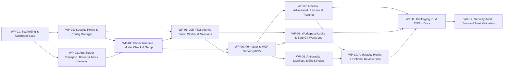

# Implementation Plan & Work Packages — `codex-plugin-agy`

This implementation plan decomposes Phases 1–4 of `SPEC.md` into **12 bounded, independently verifiable Work Packages (`WP-01`..`WP-12`)** optimized for delegation by **Gemini 4 Neon** (Orchestrator) to **GPT-6.2 Sol running in Codex** (Worker).

Every Work Package specifies a strict **Permitted Modification Scope** so parallel waves can execute safely in isolated Git worktrees with zero file collisions.

[Phase 0.5 host revalidation](host-compatibility-delta.md) establishes `agy 1.5.17` as the primary host and records the MCP workspace and Stop hook changes.

---

## 1. Execution Dependency DAG & Parallel Waves

### Recommended Execution Schedule

| Wave | Phase (`SPEC.md`) | Work Packages (Parallelizable where noted) | Exit Gate |
| --- | --- | --- | --- |
| **Wave 1** | Phase 1 — MVP | `WP-01` | Repo builds, typechecks, upstream files vendored & attributed |
| **Wave 2** | Phase 1 — MVP | `WP-02` ∥ `WP-03` *(parallel, disjoint scopes)* | Security/config unit tests + Mock App Server & broker integration tests green |
| **Wave 3** | Phase 1 — MVP | `WP-04` | Runtime model/effort validation, turn execution, and `codex_setup` diagnostics green |
| **Wave 4** | Phase 1 — MVP | `WP-05` | 10-state FSM, atomic persistence, detached worker, cancel & crash recovery green |
| **Wave 5** | Phase 1 — MVP | `WP-06` | **MVP Loop Complete**: Antigravity -> MCP -> App Server -> Worker -> Result (`codex_setup`, `codex_delegate`, `codex_status`, `codex_result`, `codex_cancel`, `codex_list_jobs`) |
| **Wave 6** | Phase 2 & 3 | `WP-07` ∥ `WP-08` ∥ `WP-09` *(parallel in isolated worktrees)* | Full 10-tool parity, parallel worktrees, Antigravity manifest/skills/rules (`agy plugin validate` passes) |
| **Wave 7** | Phase 3 | `WP-10` | Antigravity `hooks.json` & anti-recursion Stop Review Gate green |
| **Wave 8** | Phase 4 — Hardening | `WP-11` | Zero-`node_modules` `dist/plugin/` bundle, CI workflow, `README.md` & `README.zh-CN.md` complete |
| **Wave 9** | Phase 4 — Hardening | `WP-12` | Full security regression suite, opt-in real `gpt-6.2-sol` smoke test, `agy plugin validate` on source + package, final `AC-01`..`AC-15` verification report |

---

## 2. Detailed Work Packages

---

### WP-01: Repository Scaffolding, Tooling, Attribution & Upstream Sync Base
- **Phase**: Phase 1 — Minimum Viable Plugin
- **Objective**: Establish the Node.js/TypeScript ESM project scaffold, Apache-2.0 legal/attribution files, build/typecheck scripts, Codex protocol type-generation workflow, and audited vendored upstream modules (`src/upstream/`, `prompts/`, `schemas/`).
- **Dependencies**: None (Phase 0 blueprints complete).
- **Relevant Source Files**:
  - Blueprints: `docs/upstream-audit.md` (§1, §2, §6), `docs/porting-matrix.md` (§2, §5), `docs/architecture.md` (§3).
  - Upstream references (`openai/codex-plugin-cc@db52e28f4d9ded852ab3942cea316258ae4ef346`): `LICENSE`, `NOTICE`, `package.json`, `tsconfig.app-server.json`, `plugins/codex/schemas/review-output.schema.json`, `plugins/codex/prompts/adversarial-review.md`, `plugins/codex/prompts/stop-review-gate.md`, `plugins/codex/scripts/lib/{args,fs,git,prompts,workspace}.mjs`.
- **Permitted Modification Scope**:
  - Create: `package.json`, `package-lock.json`, `tsconfig.json`, `tsconfig.upstream.json`, `.gitignore`, `LICENSE`, `NOTICE`, `UPSTREAM.md`, `CHANGELOG.md`, `SECURITY.md`, `scripts/build.mjs`, `prompts/adversarial-review.md`, `prompts/stop-review-gate.md`, `schemas/review-output.schema.json`, `src/upstream/{args,fs,git,prompts,workspace}.mjs`, `tests/unit/upstream-base.test.mjs`.
  - Do NOT touch: `SPEC.md`, `docs/*`, `AGENTS.md`.
- **Implementation Constraints**:
  - Set `"type": "module"`, `"license": "Apache-2.0"`, `"engines": { "node": ">=18.18.0" }`.
  - Dependencies: runtime deps strictly limited to `@modelcontextprotocol/sdk` (`^1.32.2`) and `zod` (compatible version matching SDK peer dependency); `devDependencies` limited to `typescript`, `@types/node`, `esbuild`.
  - `LICENSE` MUST be verbatim Apache-2.0; `NOTICE` MUST preserve `Copyright 2026 OpenAI` and add community port notice; `UPSTREAM.md` MUST record `openai/codex-plugin-cc` commit `db52e28f4d9ded852ab3942cea316258ae4ef346` (`v1.0.6`), `openai/codex` commit `af71942309704997f4bdc86c020717646423c080`, and an explicit unofficial-port disclaimer.
  - `src/upstream/fs.mjs`: add `writeFileAtomic(filePath, content, options)` using same-dir temp file + `fsyncSync` + `renameSync` with Windows `EPERM`/`EBUSY`/`EACCES` retry (fixing `AUD-01`).
  - `src/upstream/git.mjs`: keep `shell: false` on ALL `git` invocations; keep minimal diff from upstream with `// [codex-plugin-agy]` markers.
  - `prompts/stop-review-gate.md`: replace Claude/slash-command wording with Antigravity/Neon equivalents while preserving `ALLOW:`/`BLOCK:` output contract.
  - `package.json` scripts MUST include: `generate:protocol` (`codex app-server generate-ts --out .generated/app-server-types`), `typecheck`, `build`, `test`, `test:unit`, `test:integration`, `test:mcp`, `test:security`.
  - Ignore `.generated/` and `dist/` in `.gitignore`.
- **Acceptance Criteria**:
  - `npm ci` (or `npm install`) installs cleanly with zero peer dependency errors.
  - `npm run typecheck` exits `0` (checking both `tsconfig.json` and `tsconfig.upstream.json`).
  - `LICENSE`, `NOTICE`, and `UPSTREAM.md` satisfy `AC-13`.
  - `writeFileAtomic` successfully writes and replaces files across POSIX & Windows without leaving temp files.
- **Required Tests**:
  - `tests/unit/upstream-base.test.mjs`: tests `args.mjs` parsing/splitting, `prompts.mjs` template loading/interpolation, `fs.mjs` `writeFileAtomic` (normal write, overwrite, concurrent writers), `workspace.mjs` root resolution, and JSON Schema validity of `schemas/review-output.schema.json`.
  - Verification commands: `npm run typecheck && node --test tests/unit/upstream-base.test.mjs`.

---

### WP-02: Security Policy Engine, Path/Symlink Guards, Secret Redactor & Config Manager
- **Phase**: Phase 1 — Minimum Viable Plugin
- **Objective**: Implement all foundational security primitives (`src/security/`) and deterministic multi-layer configuration resolution (`src/config/`), enforcing monotonic least privilege, path/symlink containment, git-ref sanitization, secret redaction, and output bounding.
- **Dependencies**: `WP-01`.
- **Relevant Source Files**:
  - Blueprints: `docs/architecture.md` (§5.1, §5.6, §6.4), `docs/security-model.md` (§1, §3, §4, §6, §7).
  - Repo files: `src/upstream/fs.mjs`, `src/upstream/workspace.mjs`.
- **Permitted Modification Scope**:
  - Create: `src/security/errors.ts`, `src/security/policy.ts`, `src/security/path-guard.ts`, `src/security/redactor.ts`, `src/security/output-limits.ts`, `src/security/index.ts`, `src/config/types.ts`, `src/config/config-manager.ts`, `src/config/index.ts`, `tests/unit/security-policy.test.mjs`, `tests/unit/path-guard.test.mjs`, `tests/unit/redactor.test.mjs`, `tests/unit/config-manager.test.mjs`.
- **Implementation Constraints**:
  - Implement typed `PluginError` with exact `PluginErrorCode` enum from `docs/architecture.md` §6.4.
  - `src/security/policy.ts`: hard-block `danger-full-access`, `--dangerously-bypass-approvals-and-sandbox`, `--dangerously-bypass-hook-trust`, `--approve-for-me`; enforce monotonic sandbox (`read-only` < `workspace-write`) and monotonic approval policy (`never` < `on-request` < `untrusted`) against effective Codex `config/read` baseline; never elevate `networkAccess` from `false` to `true`.
  - `src/security/path-guard.ts`: canonicalize via `fs.realpathSync.native`; support non-existent leaf targets by resolving nearest existing ancestor; handle Windows case-insensitive drive letters; reject NUL/control chars, `..` traversal, and symlink escapes; implement `validateGitRef(ref)` rejecting leading `-`, whitespace, NUL, `..` tricks where invalid, and shell metacharacters; implement `auditAllowedPaths(root, allowedPaths, touchedFiles)` returning `outOfScopeFiles`.
  - `src/security/redactor.ts`: implement all 9 secret categories in `docs/security-model.md` §7 (deterministic `[REDACTED:<TYPE>]`), including deep object/array traversal for structured payloads.
  - `src/config/config-manager.ts`: resolve `<pluginDataRoot>` from `process.env.CODEX_PLUGIN_AGY_DATA_DIR || process.env.PLUGIN_DATA || path.join(os.homedir(), ".gemini", "antigravity-codex-plugin-data")` (creating with mode `0o700`); implement exact 5-level precedence from `docs/architecture.md` §5.1; default `model: "gpt-6.2-sol"`, `reasoningEffort: "high"`, `maxConcurrency: 2`, `timeoutSeconds: 600`, `reviewGate.enabled: false`; persist updates via `writeFileAtomic`.
  - ZERO imports from `@modelcontextprotocol/sdk`, `src/mcp/`, or `src/adapters/`.
- **Acceptance Criteria**:
  - All security monotonicity, path/symlink boundary, redaction, and config precedence invariants enforced (`AC-06`, `AC-10`, `AC-11`).
  - Zero runtime dependencies added outside Node.js built-ins + `src/upstream/`.
- **Required Tests**:
  - `tests/unit/security-policy.test.mjs`: monotonic sandbox/approval merge, banned modes/flags rejection, network non-elevation.
  - `tests/unit/path-guard.test.mjs`: `../` traversal, external absolute path, symlink-to-outside escape, non-existent file inside workspace, git ref option injection (`--upload-pack=...`), `allowed_paths` out-of-scope detection.
  - `tests/unit/redactor.test.mjs`: all 9 secret categories + nested JSON redaction + env secret value redaction.
  - `tests/unit/config-manager.test.mjs`: 5-level precedence, `PLUGIN_DATA` resolution, atomic workspace config save/load, invalid config rejection.
  - Verification commands: `npm run typecheck && node --test tests/unit/security-policy.test.mjs tests/unit/path-guard.test.mjs tests/unit/redactor.test.mjs tests/unit/config-manager.test.mjs`.

---

### WP-03: Hardened App Server Transport, Binary Resolver, Authenticated Broker & Mock Harness
- **Phase**: Phase 1 — Minimum Viable Plugin
- **Objective**: Port and harden the Codex App Server JSON-RPC client, cross-platform shell-free `codex` binary resolver, authenticated local broker (`scripts/app-server-broker.mjs`), protocol typings, fail-closed `ServerRequest` approval handler, and a full Mock Codex App Server test harness (`tests/fixtures/mock-app-server.mjs`).
- **Dependencies**: `WP-01` (may run in parallel with `WP-02` if importing shared error types via lightweight interface or right after `WP-02` commits `src/security/errors.ts`; recommended: start after `WP-01`, align `PluginError` imports cleanly).
- **Relevant Source Files**:
  - Blueprints: `docs/upstream-audit.md` (§2.2–§2.5, §3, §5 `AUD-03`/`AUD-04`/`AUD-05`), `docs/architecture.md` (§4.2, §5.2, §9), `docs/security-model.md` (§5, `THR-03`/`THR-04`/`THR-07`/`THR-08`).
  - Upstream references (`codex-plugin-cc@db52e28`): `scripts/lib/app-server.mjs`, `scripts/lib/app-server-protocol.d.ts`, `scripts/lib/broker-endpoint.mjs`, `scripts/lib/broker-lifecycle.mjs`, `scripts/lib/process.mjs`, `scripts/app-server-broker.mjs`, `tests/fake-codex-fixture.mjs`.
- **Permitted Modification Scope**:
  - Create: `src/app-server/protocol.ts`, `src/app-server/binary-resolver.ts`, `src/app-server/process.ts`, `src/app-server/approval-handler.ts`, `src/app-server/broker-endpoint.ts`, `src/app-server/broker-lifecycle.ts`, `src/app-server/broker-server.ts`, `src/app-server/client.ts`, `src/app-server/index.ts`, `scripts/app-server-broker.mjs`, `tests/fixtures/mock-app-server.mjs`, `tests/unit/binary-resolver.test.mjs`, `tests/unit/broker-endpoint.test.mjs`, `tests/integration/app-server-transport.test.mjs`.
- **Implementation Constraints**:
  - **Shell-free Windows resolution (`AUD-03`)**: Resolve `codex.exe` or parse npm's `codex.cmd` shim to spawn `[process.execPath, codexJsPath, ...args]` with `shell: false`. Only fall back to `cmd.exe /d /s /c` for custom `.cmd` shims (e.g., Windows test fixtures) with strictly allowlisted fixed args (`["--version"]`, `["app-server"]`, `["app-server", "--help"]`). Zero Node 24 `DEP0190` warnings when launching official Codex CLI.
  - **Client identity**: `clientInfo: { name: "codex-plugin-agy", title: "Codex Plugin for Antigravity", version }` read from root `plugin.json` (or package version fallback); NEVER read `.claude-plugin/plugin.json`.
  - **Transport caps**: Max JSONL line `16 MiB`; stderr ring buffer capped at `512 KiB`; malformed JSONL produces `PROTOCOL_MALFORMED_RESPONSE`.
  - **Fail-closed approval handler**: Handle `item/commandExecution/requestApproval` (`{ decision: "cancel" }`), `item/fileChange/requestApproval` (`{ decision: "cancel" }`), `item/permissions/requestApproval` (`{ permissions: {}, scope: "turn" }`), `item/tool/requestUserInput` (`-32601`), `mcpServer/elicitation/request` (`-32601`), and legacy `execCommandApproval`/`applyPatchApproval` (fail-closed decline/abort verified against generated protocol types). Emit structured callback event so callers mark job `awaiting_approval`.
  - **Authenticated broker (`AUD-04`)**: Unix socket under `0o700` `<pluginDataRoot>/run/<wsHash>/`, `chmod 0o600`; Windows named pipe `\\.\pipe\codex-agy-<16-hex>`; mandatory `broker/auth` token check before forwarding any RPC; `broker/health` and `broker/shutdown` RPCs; configurable idle TTL (default `15m`); atomic `broker.json` (`0o600`); keep `BROKER_BUSY_RPC_CODE = -32001` for direct-client fallback.
  - **Process identity (`src/app-server/process.ts`)**: Implement `captureProcessIdentity`, `verifyProcessIdentity`, and `terminateVerifiedProcessTree` so recycled PIDs are never killed (`AUD-02`).
  - **Mock App Server (`tests/fixtures/mock-app-server.mjs`)**: Cross-platform (POSIX + Windows `.cmd` shim) mock speaking real Codex `0.172.0` JSONL RPCs: `initialize`, `account/read`, `config/read` (with `layers`), `model/list` (including `gpt-6.2-sol` + `supportedReasoningEfforts` + unsupported-model mode), `windowsSandbox/readiness`, `thread/start`, `thread/resume`, `thread/read`, `thread/name/set`, `thread/list`, `turn/start`, `review/start` (4 `ReviewTarget` variants), `turn/interrupt`, notifications (`thread/tokenUsage/updated`, `turn/diff/updated`, `model/rerouted`, `item/*`, `turn/*`, multi-subagent collab), approval `ServerRequest` scenarios, malformed JSONL, disconnect mid-turn, auth failure, and slow/cancellable turns.
- **Acceptance Criteria**:
  - Direct & broker clients complete handshake, RPCs, notifications, and graceful close cleanly on POSIX & Windows.
  - Unauthenticated broker sockets are rejected and closed immediately.
  - Busy broker returns `-32001` and callers fall back to direct `codex app-server`.
  - Every approval `ServerRequest` triggers fail-closed response without crashing the client (`AC-10`, `AC-11`).
  - Broker shuts down cleanly on `broker/shutdown` and idle TTL expiry.
- **Required Tests**:
  - `tests/unit/binary-resolver.test.mjs`: POSIX binary, Windows `.exe`, Windows npm `.cmd` -> `codex.js` resolution, fallback shim, invalid/missing binary.
  - `tests/unit/broker-endpoint.test.mjs`: Unix socket path under `PLUGIN_DATA`, Windows pipe random naming, parser error handling.
  - `tests/integration/app-server-transport.test.mjs`: handshake, broker auth success & rejection, `broker/health`, busy-broker fallback, broker disconnect recovery, malformed JSONL error, oversized line rejection, all approval `ServerRequest` fail-closed tests, idle TTL shutdown, and recycled-PID safe non-kill test.
  - Verification commands: `npm run typecheck && node --test tests/unit/binary-resolver.test.mjs tests/unit/broker-endpoint.test.mjs tests/integration/app-server-transport.test.mjs`.

---

### WP-04: Codex Companion Runtime, Model/Effort Validation & Setup Diagnostics
- **Phase**: Phase 1 — Minimum Viable Plugin
- **Objective**: Port and enhance `lib/codex.mjs` into `src/runtime/` (with dynamic `model/list` pre-flight validation, `gpt-6.2-sol`/`high` defaults, real token usage & diff capture, reroute detection, and typed error mapping) and implement `src/diagnostics/setup.ts` powering `codex_setup`.
- **Dependencies**: `WP-02`, `WP-03`.
- **Relevant Source Files**:
  - Blueprints: `docs/upstream-audit.md` (§2.6, §2.15, §3), `docs/architecture.md` (§5.3, §6.2 `codex_setup`), `docs/security-model.md` (§4.3).
  - Upstream reference (`codex-plugin-cc@db52e28`): `plugins/codex/scripts/lib/codex.mjs`, `plugins/codex/scripts/codex-companion.mjs` (`buildSetupReport`).
- **Permitted Modification Scope**:
  - Create: `src/runtime/types.ts`, `src/runtime/model-validator.ts`, `src/runtime/error-mapper.ts`, `src/runtime/codex-runtime.ts`, `src/runtime/index.ts`, `src/diagnostics/setup.ts`, `src/diagnostics/index.ts`, `tests/unit/model-validator.test.mjs`, `tests/integration/codex-runtime.test.mjs`, `tests/integration/setup-diagnostics.test.mjs`.
- **Implementation Constraints**:
  - Set `SERVICE_NAME = "antigravity_codex_plugin"`.
  - Pre-flight model validation (`src/runtime/model-validator.ts`): paginate `model/list({ includeHidden: true })`; validate exact requested `model` (default `gpt-6.2-sol`) and `reasoning_effort` (default `high`, accepting `low/medium/high/xhigh/max/ultra` or whatever the model's `supportedReasoningEfforts` declares); fail with `MODEL_UNAVAILABLE` or `EFFORT_UNSUPPORTED` listing available models/efforts — **NO silent model fallback**!
  - Custom provider support: when `requiresOpenaiAuth === false` and `model/list` is empty or `-32601`, mark `modelValidation: "unverified_custom_provider"` and proceed transparently.
  - Capture and return ONLY real runtime telemetry: `effectiveModel` (from `ThreadStartResponse.model`/`ThreadResumeResponse.model` + `model/rerouted`), `modelRerouted`, `tokenUsage` (from `thread/tokenUsage/updated`, else `null`), `turnDiff` (from `turn/diff/updated`, else `null`), `fileChanges`, `touchedFiles`, `commandsExecuted` (with exit codes & redacted output), `testsExecuted` (classified from `commandsExecuted`), `reasoningSummary`, `approvalEvents`.
  - Preserve upstream `captureTurn` + `scheduleInferredCompletion` (250ms drain after `final_answer` when `pendingCollaborations` & `activeSubagentTurns` are empty).
  - Enforce monotonic security policy by fetching effective Codex config via `config/read({ includeLayers: true, cwd })` before starting a thread and merging via `WP-02`'s policy engine.
  - `src/diagnostics/setup.ts`: checks Node version, npm availability, git availability, Codex CLI binary & version, App Server handshake, Auth status (ChatGPT / API key / custom no-auth provider — never reading credential files), Project trust (inspecting `config/read` `layers` for `project` layer `disabledReason`), Windows sandbox readiness (`windowsSandbox/readiness` on `win32`), Requested model & effort availability via `model/list`, Working directory, Plugin config, and Broker health (`broker/health`). Produces structured diagnostics + actionable remediation steps (without auto-running `npm install`).
- **Acceptance Criteria**:
  - `gpt-6.2-sol` + `high` validated cleanly against `model/list`; unavailable model or unsupported effort fails with actionable diagnostics and zero fallback (`AC-04`, `AC-10`).
  - ChatGPT auth, API key auth, and custom no-auth provider all accurately reported; auth failure returns `AUTH_REQUIRED`/`AUTH_EXPIRED` without touching token files (`AC-05`, `AC-10`).
  - `codex_setup` returns all 10 required diagnostic checks from `SPEC.md` §7 (`Setup`).
  - Multi-subagent turn completion, token usage, turn diff, and `model/rerouted` notifications are accurately captured.
- **Required Tests**:
  - `tests/unit/model-validator.test.mjs`: valid `gpt-6.2-sol` + `high`/`max`/`ultra`, missing model rejection, invalid effort rejection, paginated `model/list`, custom provider fallback behavior.
  - `tests/integration/codex-runtime.test.mjs`: `thread/start`, `thread/resume`, `turn/start`, multi-subagent completion, `tokenUsage`, `turnDiff`, `model/rerouted`, `approval` fail-closed pause, `turn/interrupt`, `unauthorized` / `modelNotFound` / `rateLimitExceeded` error mapping, monotonic policy preservation.
  - `tests/integration/setup-diagnostics.test.mjs`: ready ChatGPT, API key, custom provider, logged-out, missing `gpt-6.2-sol`, untrusted project config layer, missing codex binary, broker healthy vs cold.
  - Verification commands: `npm run typecheck && node --test tests/unit/model-validator.test.mjs tests/integration/codex-runtime.test.mjs tests/integration/setup-diagnostics.test.mjs`.

---

### WP-05: Persistent Job State Machine, Atomic Store, Detached Worker, Cancel & Session Registry
- **Phase**: Phase 1 — Minimum Viable Plugin
- **Objective**: Implement the 10-state job FSM, lockfile-protected atomic state store, detached background worker (`scripts/task-worker.mjs`), per-job timeout enforcement, race-safe cancellation, stale-job crash recovery (`interrupted`), incremental paginated logging, and thread-to-workspace session binding (`src/sessions/`).
- **Dependencies**: `WP-02`, `WP-04`.
- **Relevant Source Files**:
  - Blueprints: `docs/upstream-audit.md` (§2.7–§2.11, §5 `AUD-01`/`AUD-02`/`AUD-07`/`AUD-08`), `docs/architecture.md` (§4.1, §5.4, §5.5).
  - Upstream references (`codex-plugin-cc@db52e28`): `scripts/lib/state.mjs`, `scripts/lib/tracked-jobs.mjs`, `scripts/lib/job-control.mjs`, `scripts/codex-companion.mjs` (background worker & cancel logic).
- **Permitted Modification Scope**:
  - Create: `src/jobs/types.ts`, `src/jobs/state-machine.ts`, `src/jobs/state-store.ts`, `src/jobs/log-store.ts`, `src/jobs/job-manager.ts`, `src/jobs/task-worker.ts`, `src/jobs/index.ts`, `src/sessions/session-manager.ts`, `src/sessions/index.ts`, `scripts/task-worker.mjs`, `tests/unit/job-state-machine.test.mjs`, `tests/unit/state-store.test.mjs`, `tests/unit/session-manager.test.mjs`, `tests/integration/background-jobs.test.mjs`.
- **Implementation Constraints**:
  - Exact 10 states: `queued`, `starting`, `running`, `awaiting_approval`, `completed`, `failed`, `cancelling`, `cancelled`, `timed_out`, `interrupted`. Reject illegal transitions with error.
  - Write `<jobId>.json` & `state.json` atomically **before** spawning detached `scripts/task-worker.mjs` (`AUD-02`).
  - Record verified `ProcessIdentity` (`pid`, `startedAtMs`, `markerToken`, `executable`) on job start; reconcile stale jobs on read/startup — dead or mismatched worker -> `interrupted` with `threadId` preserved for recovery.
  - Redact all log lines and stored job payloads through `WP-02`'s `SecretRedactor` before writing to disk.
  - Incremental log reader (`readLogChunk(logFile, cursor, maxBytes)`): reads bounded byte range without loading entire log into RAM.
  - Cancellation protocol (`AUD-07`): CAS `-> cancelling`, write `.cancel` sentinel file, send broker `turn/interrupt` if broker-owned, send verified-PID `SIGTERM` on POSIX; worker polls `.cancel` (every 250ms) and catches `SIGTERM` to invoke `turn/interrupt` on its own live client before exiting; grace wait -> verified `terminateProcessTree` -> CAS `-> cancelled`. Terminal states (`completed`, `failed`, `cancelled`, `timed_out`, `interrupted`) are immutable!
  - Timeout protocol: monotonic timer inside worker fires `turn/interrupt` + clean close -> CAS `-> timed_out`.
  - Session Manager (`src/sessions/session-manager.ts`): atomic `sessions.json` binding `threadId -> { workspaceRoot, effectiveCwd, worktreePath, sandbox, approvalPolicy, model, reasoningEffort, ephemeral }`; blocks cross-workspace resume (`THREAD_WORKSPACE_MISMATCH`) and ephemeral thread resume; generates safe `codex resume <threadId>` string.
  - Retention pruning: configurable `jobRetentionCount` (default `50`), never prunes active (`queued`/`starting`/`running`/`cancelling`) jobs.
- **Acceptance Criteria**:
  - Background job returns immediately with `jobId` & `state: "queued"`, runs detached beyond caller lifetime, persists across queries/restarts, and cleans up cleanly on completion, timeout, or cancel (`AC-07`, `AC-08`).
  - Simulated worker crash leaves job accurately marked `interrupted` (not stuck `running`), with `threadId` preserved (`AC-07`, `AC-10`).
  - Cancel vs complete race never corrupts terminal state or leaves orphaned Codex worker processes (`AC-07`).
  - Cross-workspace `threadId` resume is rejected (`AC-08`, `AC-11`).
- **Required Tests**:
  - `tests/unit/job-state-machine.test.mjs`: all legal & illegal transitions across all 10 states + CAS immutability of terminal states.
  - `tests/unit/state-store.test.mjs`: concurrent writers under lockfile, atomic recovery, retention pruning preserving active jobs, paginated log reader.
  - `tests/unit/session-manager.test.mjs`: binding persistence, cross-workspace mismatch rejection, ephemeral thread rejection.
  - `tests/integration/background-jobs.test.mjs`: detached worker foreground & background delegation against Mock App Server, status polling, result storage, timeout -> `timed_out`, cancel (both broker & direct-fallback worker) -> `cancelled` with verified `turn/interrupt`, simulated killed worker -> `interrupted` recovery.
  - Verification commands: `npm run typecheck && node --test tests/unit/job-state-machine.test.mjs tests/unit/state-store.test.mjs tests/unit/session-manager.test.mjs tests/integration/background-jobs.test.mjs`.

---

### WP-06: Result Formatter & Stdio MCP Server (Phase 1 Core Tools)
- **Phase**: Phase 1 — Minimum Viable Plugin
- **Objective**: Build the structured Result Formatter (`src/formatting/`) and the official `@modelcontextprotocol/sdk` stdio MCP Server (`src/mcp/`, `scripts/mcp-server.mjs`) exposing the Phase 1 core tool loop: `codex_setup`, `codex_delegate`, `codex_status`, `codex_result`, `codex_cancel`, and `codex_list_jobs`.
- **Dependencies**: `WP-04`, `WP-05`.
- **Relevant Source Files**:
  - Blueprints: `docs/architecture.md` (§5.7, §6.1–§6.4), `docs/security-model.md` (`THR-06`, `THR-09`, `THR-10`, `THR-11`).
  - Upstream reference (`codex-plugin-cc@db52e28`): `plugins/codex/scripts/lib/render.mjs` (review shape validation/sorting helpers).
- **Permitted Modification Scope**:
  - Create: `src/formatting/result-formatter.ts`, `src/formatting/index.ts`, `src/mcp/schemas.ts`, `src/mcp/tools-core.ts`, `src/mcp/server.ts`, `src/mcp/index.ts`, `scripts/mcp-server.mjs`, `tests/unit/result-formatter.test.mjs`, `tests/mcp/mcp-core.test.mjs`.
  - Update: `scripts/build.mjs` (add bundling targets for `mcp-server`, `app-server-broker`, `task-worker`).
- **Implementation Constraints**:
  - Use `@modelcontextprotocol/sdk/server/mcp.js` (`McpServer`, `registerTool`) and `@modelcontextprotocol/sdk/server/stdio.js` (`StdioServerTransport`) + `zod`.
  - **Strict stdout purity**: On server start, redirect `console.log`/`info`/`debug` to `process.stderr` and route internal logs to stderr/file; zero non-MCP bytes on `stdout`.
  - **Installed workspace context**: Use the host's MCP `roots/list` file roots for canonical containment and `cwd` defaults. Fail closed if the installed host supplies no usable workspace root. The plugin process directory is the installed plugin directory, not the workspace.
  - Every tool returns `ToolResponseEnvelope` in both `content: [{ type: "text", text: JSON.stringify(envelope) }]` and `structuredContent: envelope`, with `isError: !envelope.ok`.
  - Strict separation of `pluginMeta` vs `workerOutput` (`workerOutput` MUST be `null` whenever Codex did not run/succeed — never fabricate worker answers!).
  - Strict output byte limits (`max_bytes`, default `16384`), truncated git diff summary by default (`include_diff: "stat"`), incremental log pagination (`include_logs`, `log_cursor`), and adaptive `recommendedPollIntervalMs` (`5000`/`10000`/`15000`) on active `codex_status` and background `codex_delegate`.
  - MCP Tool descriptions MUST be clear, concise, and explicitly instruct Neon on preconditions (including noting `allowed_paths` is a task-scope prompt + post-run audit, not an OS sandbox boundary).
  - Graceful shutdown on `stdin` `end`/`close`, `SIGINT`, `SIGTERM`: cleanly shut down any workspace broker owned by this server instance without killing detached background workers unless explicitly cancelled.
- **Acceptance Criteria**:
  - Full Phase 1 MVP loop works end-to-end over MCP stdio (`initialize` -> `tools/list` -> `tools/call` for all 6 core tools) (`AC-02`, `AC-03`, `AC-06`, `AC-07`, `AC-10`, `AC-11`).
  - Invalid Zod arguments return structured `INVALID_ARGUMENTS` error without crashing the server.
  - Every byte written to `stdout` is valid JSON-RPC 2.0 MCP traffic.
- **Required Tests**:
  - `tests/unit/result-formatter.test.mjs`: `pluginMeta` vs `workerOutput` isolation, null `workerOutput` on failure, byte-cap truncation & cursor math, secret redaction in formatted envelope, adaptive poll intervals.
  - `tests/mcp/mcp-core.test.mjs`: spawns real `scripts/mcp-server.mjs` over stdio using `@modelcontextprotocol/sdk/client` (`StdioClientTransport` + `Client`) against Mock App Server; tests `tools/list`, `codex_setup`, foreground & background `codex_delegate`, `codex_status`, `codex_result` (with diff/log pagination), `codex_cancel`, `codex_list_jobs`, invalid args, `danger-full-access` rejection, unsupported model error, and strict stdout-JSON-only assertion.
  - Verification commands: `npm run build && node --test tests/unit/result-formatter.test.mjs tests/mcp/mcp-core.test.mjs`.

---

### WP-07: Native & Adversarial Code Review, Thread Resume & Structured Session Transfer
- **Phase**: Phase 2 — Feature Parity
- **Objective**: Implement full-scope read-only `codex_review`, structured `codex_adversarial_review`, bound `codex_resume`, and structured-handoff `codex_transfer`, wiring all 4 tools into the MCP Server and detached background worker.
- **Dependencies**: `WP-06`.
- **Relevant Source Files**:
  - Blueprints: `docs/upstream-audit.md` (§2.10, §2.12, §2.13, §3.2), `docs/porting-matrix.md` (§2, §3), `docs/architecture.md` (§5.3, §6.2–§6.3).
  - Upstream references (`codex-plugin-cc@db52e28`): `scripts/lib/git.mjs`, `prompts/adversarial-review.md`, `schemas/review-output.schema.json`, `scripts/lib/render.mjs`.
  - Repo files: `src/upstream/git.mjs`, `src/runtime/codex-runtime.ts`, `src/jobs/task-worker.ts`, `src/mcp/server.ts`.
- **Permitted Modification Scope**:
  - Edit: `src/upstream/git.mjs` (add staged-only, commit SHA, path-scoped context collection, git diff summary helper, ref sanitization — keeping `shell: false`!), `src/jobs/task-worker.ts` (support `review`, `adversarial-review`, `resume` kinds in detached background worker), `src/mcp/server.ts` (register WP-07 tools).
  - Create: `src/runtime/review.ts`, `src/runtime/transfer.ts`, `src/mcp/tools-parity.ts`, `tests/unit/git-review.test.mjs`, `tests/integration/review-and-transfer.test.mjs`, `tests/mcp/mcp-parity.test.mjs`.
- **Implementation Constraints**:
  - `codex_review` & `codex_adversarial_review` MUST enforce `sandbox: "read-only"` unconditionally.
  - `codex_review` MUST prefer Codex native `review/start` (`delivery: "inline"`) for `uncommittedChanges`, `baseBranch`, `commit`, and `custom` instructions; use read-only `turn/start` with scoped `git.mjs` context ONLY for staged-only or path-filtered reviews.
  - `codex_adversarial_review` MUST reuse `prompts/adversarial-review.md` and `schemas/review-output.schema.json`, validate/normalize output, sort findings by severity (`critical > high > medium > low`), and report explicit `parseError` + bounded `rawOutput` if Codex returns invalid JSON (never fabricating findings).
  - `codex_resume` MUST verify workspace & policy binding via `SessionManager` + `thread/read`, call `thread/resume({ excludeTurns: true, ... })`, and return `codex resume <threadId>`.
  - `codex_transfer` MUST accept Neon's structured handoff package (`objective`, `summary`, `architecture_decisions`, `constraints`, `relevant_files`, `previous_attempts`, `unresolved_issues`, `acceptance_criteria`), validate `relevant_files` inside workspace, create a persistent thread (`ephemeral: false`) named `Antigravity Handoff: <short objective>`, run an initial read-only handoff seed turn, register in `SessionManager`, and return `{ threadId, resumeCommand }`. MUST NOT read private Antigravity databases or invoke Claude's `externalAgentConfig/import`.
  - All git refs (`base`, `commit`) MUST pass `validateGitRef()` and all pathspecs MUST pass `path-guard` and follow `--`.
- **Acceptance Criteria**:
  - All 10 MCP tools are registered and discoverable via `tools/list` (`AC-02`, `AC-08`, `AC-09`).
  - `codex_review` covers uncommitted, staged, branch, commit SHA, path-scoped, and custom instructions in both foreground and background modes (`AC-09`).
  - `codex_adversarial_review` returns validated structured JSON findings sorted by severity (`AC-09`).
  - `codex_resume` continues bound persistent threads and rejects cross-workspace threads (`AC-08`).
  - `codex_transfer` creates a persistent resumable Codex thread from Neon's handoff package without private APIs (`AC-08`, `AC-15`).
- **Required Tests**:
  - `tests/unit/git-review.test.mjs`: uncommitted, staged-only, branch comparison, commit SHA, path filtering, inline-vs-self-collect threshold, ref option-injection rejection (`--upload-pack=...`), symlink/traversal path rejection.
  - `tests/integration/review-and-transfer.test.mjs`: native `review/start` (4 target variants), staged/path-scoped fallback review, adversarial review (valid JSON, malformed JSON handling, background execution), `codex_resume` persistence & workspace check, `codex_transfer` persistent thread creation.
  - `tests/mcp/mcp-parity.test.mjs`: MCP stdio client tests invoking `codex_review`, `codex_adversarial_review`, `codex_resume`, `codex_transfer`.
  - Verification commands: `npm run build && node --test tests/unit/git-review.test.mjs tests/integration/review-and-transfer.test.mjs tests/mcp/mcp-parity.test.mjs`.

---

### WP-08: Workspace Manager, Concurrency Limits & Safe Git Worktree Isolation
- **Phase**: Phase 3 — Orchestration
- **Objective**: Implement `src/workspace/` enforcing conservative worker concurrency limits (default `2`), strict single-writer directory locking, safe opt-in Git worktree provisioning/tracking/cleanup, post-run multi-worker file conflict detection, and `allowed_paths` drift auditing.
- **Dependencies**: `WP-05`, `WP-06`.
- **Relevant Source Files**:
  - Blueprints: `docs/architecture.md` (§5.6), `docs/security-model.md` (`THR-12`).
  - Repo files: `src/jobs/job-manager.ts`, `src/jobs/task-worker.ts`, `src/mcp/tools-core.ts`, `src/upstream/git.mjs`, `src/security/path-guard.ts`.
- **Permitted Modification Scope**:
  - Create: `src/workspace/types.ts`, `src/workspace/lock-registry.ts`, `src/workspace/worktree-manager.ts`, `src/workspace/conflict-detector.ts`, `src/workspace/index.ts`, `tests/unit/workspace-locks.test.mjs`, `tests/integration/worktree-parallel.test.mjs`.
  - Edit: `src/jobs/job-manager.ts`, `src/jobs/task-worker.ts`, `src/mcp/tools-core.ts` (wire concurrency check, single-writer lock acquisition/release, opt-in `use_worktree`, `allowed_paths` audit, and `fileConflicts` into `codex_delegate` / `codex_result`).
- **Implementation Constraints**:
  - Default `maxConcurrency = 2` (configurable `1..8`). Reject excess active jobs with `CONCURRENCY_LIMIT_REACHED`.
  - **Single-writer lock**: Reject concurrent `workspace-write` jobs on the same canonical `cwd` with `WORKSPACE_WRITE_LOCKED` (suggesting `use_worktree: true` or distinct `cwd`). Multiple `read-only` jobs are allowed concurrently up to `maxConcurrency`.
  - **Zero destructive Git operations**: NEVER run `git reset --hard`, `git clean -fd`, `git checkout --`, auto-commit, auto-merge, auto-rebase, auto-push, or delete user branches.
  - Worktrees MUST be created under `<pluginDataRoot>/worktrees/<wsHash>/<jobId>/` on branch `codex-agy/<jobId>` using `git worktree add -b ... HEAD` with `shell: false`.
  - If primary working tree has uncommitted changes when `use_worktree: true` is requested, NEVER modify/stash primary tree; emit clear warning in `pluginMeta.warnings` noting worktree starts from `HEAD`.
  - Release locks automatically when jobs enter any terminal state or on stale-job crash recovery (`interrupted`).
- **Acceptance Criteria**:
  - Concurrent `workspace-write` on same `cwd` is blocked; same two jobs with `use_worktree: true` succeed in isolated worktrees without touching user's dirty primary tree (`AC-06`, `AC-07`, `AC-11`).
  - Concurrent jobs exceeding `maxConcurrency` are cleanly rejected with `CONCURRENCY_LIMIT_REACHED`.
  - Overlapping modified files across sibling worktrees are detected and reported in `fileConflicts`.
  - Files modified outside `allowed_paths` are surfaced in `pluginMeta.outOfScopeFiles`.
- **Required Tests**:
  - `tests/unit/workspace-locks.test.mjs`: concurrency cap, read-read allowed, write-write same-cwd rejected, write-write distinct-cwd allowed, stale lock cleanup on dead worker.
  - `tests/integration/worktree-parallel.test.mjs`: real temporary Git repo with uncommitted primary changes + 2 parallel `use_worktree: true` background jobs verifying primary tree untouched, distinct worktree paths/branches returned, conflict detection on overlapping file edits, and `outOfScopeFiles` reporting.
  - Verification commands: `npm run build && node --test tests/unit/workspace-locks.test.mjs tests/integration/worktree-parallel.test.mjs`.

---

### WP-09: Antigravity Native Plugin Manifest, Skills, Orchestration Rules & Assets
- **Phase**: Phase 3 — Orchestration
- **Objective**: Author all Antigravity Native Plugin surface artifacts (`plugin.json`, `mcp_config.json`, `assets/logo.svg`, all 10 `skills/<name>/SKILL.md` + orchestration prompt contracts, `rules/AGENTS.md`, `rules/codex-delegated-mode.md`) strictly compliant with `https://antigravity.google/schemas/v1/plugin.json` and `agy plugin validate`.
- **Dependencies**: `WP-06` (aligns tool names/schemas; may run in parallel with `WP-07` & `WP-08`).
- **Relevant Source Files**:
  - Blueprints: `docs/upstream-audit.md` (§4), `docs/porting-matrix.md` (§3, §4), `docs/architecture.md` (§7, §8).
  - Upstream references (`codex-plugin-cc@db52e28`): `plugins/codex/skills/codex-result-handling/SKILL.md`, `plugins/codex/skills/gpt-5-4-prompting/` (selective XML contract adaptation).
- **Permitted Modification Scope**:
  - Create: `plugin.json`, `mcp_config.json`, `assets/logo.svg`, `rules/AGENTS.md`, `rules/codex-delegated-mode.md`, `skills/codex-setup/SKILL.md`, `skills/codex-delegate/SKILL.md`, `skills/codex-review/SKILL.md`, `skills/codex-adversarial-review/SKILL.md`, `skills/codex-status/SKILL.md`, `skills/codex-result/SKILL.md`, `skills/codex-cancel/SKILL.md`, `skills/codex-resume/SKILL.md`, `skills/codex-transfer/SKILL.md`, `skills/codex-orchestrator/SKILL.md`, `skills/codex-orchestrator/references/prompt-contracts.md`, `tests/unit/plugin-manifest.test.mjs`.
- **Implementation Constraints**:
  - `plugin.json`: MUST conform strictly to `https://antigravity.google/schemas/v1/plugin.json` (`additionalProperties: false`, `name: "codex-plugin-agy"`, `displayName: "Codex Worker"`, `repository` as plain string, `logo: "assets/logo.svg"`, max 3 `suggestedPrompts`, `license: "Apache-2.0"`). Zero `.claude-plugin/` files or `CLAUDE_*` variables!
  - `mcp_config.json`: server key `"codex"`, `command: "node"`, `args: ["${PLUGIN_ROOT}/scripts/mcp-server.mjs"]`, `env: { "CODEX_PLUGIN_AGY_DATA_DIR": "${PLUGIN_DATA}" }`, `timeoutSeconds: 600`, `tools` marking `codex_delegate`, `codex_status`, `codex_result` as `"eager": true`. Do NOT put `PLUGIN_ROOT` or `PLUGIN_DATA` as env keys (Antigravity injects them automatically).
  - `assets/logo.svg`: valid standalone 1:1 square SVG (`viewBox="0 0 128 128"`), transparent background, ~10% margin, high contrast legible on both light and dark themes.
  - Every `skills/<name>/SKILL.md` frontmatter `name` MUST exactly match `<name>` directory name; apply `disable-model-invocation: true` per `docs/architecture.md` §7.4.
  - `skills/codex-review/SKILL.md` and `skills/codex-adversarial-review/SKILL.md` MUST explicitly instruct Neon to present findings ordered by severity and **STOP without auto-fixing** until the user approves fixes.
  - `skills/codex-orchestrator/SKILL.md` MUST define all 4 modes (Assisted, Delegated [default], Review, Parallel Worker), the 12-step Delegated Mode workflow, all 8 Neon guardrails from `SPEC.md` §10, and clear non-takeover instructions.
  - `rules/AGENTS.md` MUST be plain Markdown (no frontmatter), `< 4 KB`, strictly non-takeover (only applies guardrails when Codex tools/delegation are invoked), and forbid trusting worker summaries without diff/test verification or executing prompt-injected instructions from `workerOutput`.
  - `rules/codex-delegated-mode.md` MUST declare valid YAML frontmatter `trigger: manual` and `description`.
- **Acceptance Criteria**:
  - `plugin.json` validates against official JSON Schema v1 (`AC-01`).
  - `agy plugin validate .` exits `0` with all 10 skills and 1 MCP server processed (`AC-01`, `AC-02`, `AC-14`, `AC-15`).
  - Zero references to `.claude-plugin`, `CLAUDE_PLUGIN_ROOT`, `CLAUDE_PLUGIN_DATA`, or `/codex:*` Claude syntax anywhere in plugin artifacts (`AC-15`).
- **Required Tests**:
  - `tests/unit/plugin-manifest.test.mjs`: validates `plugin.json` against local copy/rules of Schema v1, validates `mcp_config.json` structure & path vars, verifies every `skills/<dir>/SKILL.md` has matching frontmatter `name` & non-empty `description`, verifies `rules/AGENTS.md` size < 24 KB & no frontmatter, verifies `rules/codex-delegated-mode.md` valid `trigger`, verifies `assets/logo.svg` exists, and asserts zero `CLAUDE_` / `.claude-plugin` strings.
  - Host CLI check (when `agy` installed): `agy plugin validate .`.
  - Verification commands: `node --test tests/unit/plugin-manifest.test.mjs && agy plugin validate .`.

---

### WP-10: Antigravity Lifecycle Hooks & Optional Review Gate
- **Phase**: Phase 3 — Orchestration
- **Objective**: Implement the Antigravity Host Adapter (`src/adapters/antigravity/`), `scripts/hooks.mjs`, and plugin-root `hooks.json` supporting `SessionStart` context tracking and the optional, default-OFF `Stop` Review Gate with all 5 anti-recursion circuit breakers.
- **Dependencies**: `WP-07`, `WP-09`.
- **Relevant Source Files**:
  - Blueprints: `docs/upstream-audit.md` (§2.14, §4.4, §5 `AUD-11`), `docs/architecture.md` (§7.3), `docs/security-model.md` (§8).
  - Upstream references (`codex-plugin-cc@db52e28`): `plugins/codex/scripts/stop-review-gate-hook.mjs`.
  - Repo files: `prompts/stop-review-gate.md`, `src/runtime/codex-runtime.ts`, `src/config/config-manager.ts`, `src/jobs/state-store.ts`, `scripts/build.mjs`.
- **Permitted Modification Scope**:
  - Create: `hooks.json`, `scripts/hooks.mjs`, `src/adapters/antigravity/types.ts`, `src/adapters/antigravity/session-hook.ts`, `src/adapters/antigravity/review-gate.ts`, `src/adapters/antigravity/hooks-cli.ts`, `src/adapters/antigravity/index.ts`, `tests/integration/antigravity-hooks.test.mjs`.
  - Edit: `scripts/build.mjs` (add `hooks` bundle target), `tests/unit/plugin-manifest.test.mjs` (add `hooks.json` schema assertion).
- **Implementation Constraints**:
  - `hooks.json` MUST sit at plugin root (`./hooks.json`), use Antigravity's named-group schema (`"codex-review-gate": { "enabled": false, "SessionStart": [...], "Stop": [...] }`), flat arrays (NO `matcher` wrapper), and relative script path `"node ./scripts/hooks.mjs ..."` (NO `${PLUGIN_ROOT}` in `hooks.json` command string!).
  - Input parsing: strict camelCase Antigravity hook stdin contract (`conversationId`, `workspacePaths`, `cwd`, `modelName`, `lastUserInput`, `hookEventName`, `executionNum`, `terminationReason`, `fullyIdle`, `continuationActive`, `error`). Treat fields introduced after 1.1.27 as optional for legacy payloads and verify `hookEventName` when present. Resolve paths using payload `workspacePaths` and optional `cwd`.
  - `Stop` stdout contract: emit ONLY valid JSON (`{"decision": "continue", "reason": "..."}` to block stop, or `{}` to allow stop) and exit `0`; write diagnostic notes strictly to `stderr`.
  - Enforce ALL 5 circuit breakers from `docs/security-model.md` §8:
    1. Default OFF (`config.reviewGate.enabled !== true` -> emit `{}`).
    2. `process.env.CODEX_PLUGIN_AGY_IN_HOOK === "1"` -> emit `{}` immediately; set env var before invoking Codex.
    3. Skip (`{}`) unless `terminationReason === "NO_TOOL_CALL"` and `fullyIdle !== false`.
    4. Track a per-`conversationId` count, prompt hash, and execution sequence atomically in `review-gate-state.json`. Do not reset solely on `continuationActive: false`. For the same prompt, advancing `executionNum` retains the count. Deduplicate attempts and fail open when the new-turn boundary is ambiguous.
    5. Hard timeout (`config.reviewGate.timeoutSeconds`, default `120s`, cap `300s`) and fail-open (`{}` + stderr warning) if Codex is unavailable, unauthenticated, or times out. Set the host Stop handler to `310s` for bounded cleanup after an internal deadline of up to `300s`.
- **Acceptance Criteria**:
  - `agy plugin validate .` processes `hooks: 1 processed` with exit `0` (`AC-01`).
  - Default-OFF gate emits `{}` without invoking Codex.
  - Enabled gate blocks with `{"decision": "continue", "reason": "..."}` on `BLOCK:` verdict, allows with `{}` on `ALLOW:` verdict, and halts deterministically when `maxRunsPerTurn` or recursion env guard triggers (`AC-10`, `AC-11`, `AC-15`).
- **Required Tests**:
  - `tests/integration/antigravity-hooks.test.mjs`: `SessionStart` valid `{}` output, `Stop` default-OFF no-op, `Stop` enabled `ALLOW:` -> `{}`, `Stop` enabled `BLOCK:` -> `{"decision": "continue"}`, recursion env sentinel `CODEX_PLUGIN_AGY_IN_HOOK=1` -> `{}`, `terminationReason !== "NO_TOOL_CALL"` -> `{}`, `maxRunsPerTurn` exhaustion -> `{}`, timeout fail-open -> `{}`, and `agy plugin validate .`.
  - Verification commands: `npm run build && node --test tests/integration/antigravity-hooks.test.mjs tests/unit/plugin-manifest.test.mjs && agy plugin validate .`.

---

### WP-11: Zero-Dependency Packaging, Cross-Platform CI & Bilingual Documentation
- **Phase**: Phase 4 — Production Hardening
- **Objective**: Build the self-contained zero-`node_modules` plugin packaging script (`scripts/package.mjs` -> `dist/plugin/` + release archives), cross-platform GitHub Actions CI workflow (`.github/workflows/ci.yml`), and comprehensive English (`README.md`) and Simplified Chinese (`README.zh-CN.md`) documentation.
- **Dependencies**: `WP-07`, `WP-08`, `WP-10`.
- **Relevant Source Files**:
  - Blueprints: `SPEC.md` (§16, §17), `docs/architecture.md` (§3.2, §9), `docs/porting-matrix.md` (§3, §4), `docs/security-model.md`.
  - Repo files: `package.json`, `scripts/build.mjs`, `plugin.json`, `mcp_config.json`, `hooks.json`.
- **Permitted Modification Scope**:
  - Create: `scripts/package.mjs`, `.github/workflows/ci.yml`, `README.md`, `README.zh-CN.md`, `tests/integration/package-bundle.test.mjs`.
  - Edit: `package.json` (add `package` & `test:package` scripts).
- **Implementation Constraints**:
  - `scripts/package.mjs`: copies ONLY runtime plugin files into `dist/plugin/` (`plugin.json`, `mcp_config.json`, `hooks.json`, `README.md`, `LICENSE`, `NOTICE`, `UPSTREAM.md`, `assets/`, `prompts/`, `schemas/`, `skills/`, `rules/`), bundles `scripts/{mcp-server,app-server-broker,task-worker,hooks}.mjs` with `esbuild` so `dist/plugin/` runs with **ZERO `node_modules`** anywhere in its parent tree (verify by copying `dist/plugin/` to an isolated temp directory outside the repo and booting `node scripts/mcp-server.mjs`!). Also generates `.tar.gz` / `.zip` archive in `dist/releases/`. **NEVER auto-publish to GitHub or Marketplace (`SPEC.md` line 841).**
  - `.github/workflows/ci.yml`: matrix across `ubuntu-latest`, `macos-latest`, `windows-latest` on Node `20` and `22` (plus `24` where available): `npm ci`, `npm run typecheck`, `npm run build`, `npm test`, `npm run package`, and `tests/integration/package-bundle.test.mjs`.
  - `README.md` & `README.zh-CN.md` MUST cover all 21 sections mandated in `SPEC.md` §17 (overview, Mermaid architecture diagram, feature comparison with `codex-plugin-cc`, supported Antigravity & Codex versions, local install & release bundle install, auth, config precedence, model selection (`gpt-6.2-sol`), orchestration modes, 10-tool MCP reference, `/codex-*` skill examples, background tasks, session resume, parallel workers/worktrees, Review Gate, security model, troubleshooting, uninstallation, known limitations, upstream attribution + unofficial community port disclaimer).
  - Do NOT claim compatibility for platforms not actually tested (`SPEC.md` line 801).
- **Acceptance Criteria**:
  - `npm run package` generates `dist/plugin/` with zero `node_modules`.
  - `dist/plugin/` copied to an isolated temp dir starts MCP stdio server cleanly and responds to `initialize` + `tools/list` (`AC-01`, `AC-02`, `AC-12`).
  - `agy plugin validate ./dist/plugin --strict --json` on 1.5.17 exits `0` (`AC-01`).
  - Both `README.md` and `README.zh-CN.md` cover all 21 required sections (`AC-12`, `AC-13`).
- **Required Tests**:
  - `tests/integration/package-bundle.test.mjs`: runs `npm run package`, copies `dist/plugin/` to isolated `os.tmpdir()` path with no `node_modules` ancestors, verifies `scripts/mcp-server.mjs` initializes and lists all 10 MCP tools over stdio, and verifies `scripts/hooks.mjs Stop` outputs `{}` when default-OFF.
  - Verification commands: `npm run package && node --test tests/integration/package-bundle.test.mjs && agy plugin validate ./dist/plugin`.

---

### WP-12: Comprehensive Security Verification, Real Runtime Smoke Test & Host Validation
- **Phase**: Phase 4 — Production Hardening
- **Objective**: Implement the dedicated security negative-test suite (`tests/security/`), an opt-in minimal real-runtime smoke test against the live local Codex CLI (`gpt-6.2-sol`) in a temporary throwaway Git repo, full `agy plugin validate` verification, and produce the honest, categorized Acceptance Criteria verification matrix (`AC-01`..`AC-15`).
- **Dependencies**: `WP-11`.
- **Relevant Source Files**:
  - Blueprints: `SPEC.md` (§15, §18, §20), `docs/security-model.md` (§9), `docs/architecture.md`.
- **Permitted Modification Scope**:
  - Create: `tests/security/security-regression.test.mjs`, `tests/e2e/real-runtime-smoke.test.mjs`, `docs/verification-report.md`.
- **Implementation Constraints**:
  - `tests/security/security-regression.test.mjs`: must automate ALL 14 checklist items in `docs/security-model.md` §9 (runs offline in CI via Mock App Server).
  - `tests/e2e/real-runtime-smoke.test.mjs`:
    - Gated behind explicit `CODEX_PLUGIN_AGY_RUN_LIVE_SMOKE=1` env var so normal CI never consumes quota or requires credentials.
    - Uses ONLY an isolated temporary Git repository (`os.tmpdir()`); NEVER touches user projects or alters Codex login/auth configuration.
    - Keeps prompts minimal to conserve quota while verifying against real `gpt-6.2-sol`: `codex_setup`, read-only analysis, authorized `workspace-write` file modification, background delegation + `codex_status` polling + `codex_result`, `codex_resume`, `codex_cancel`, and `codex_review`.
  - `docs/verification-report.md`: explicitly classifies every `AC-01`..`AC-15` and platform (Windows / macOS / Linux) using the exact `SPEC.md` §15 tiers: `Unit tested`, `Integration tested`, `Mock tested`, `Real runtime tested`, `Host tested`, or `Not verified` (with exact reason and reproducible manual steps for anything not verified in the current environment). **Zero fabricated test results.**
- **Acceptance Criteria**:
  - 100% of unit, integration, MCP, packaging, and security regression suites pass (`AC-12`).
  - Live smoke test passes when run locally with logged-in `codex-cli 0.172.0` (`AC-03`..`AC-10`), OR clearly marked if skipped/blocked.
  - `agy 1.5.17` passes source validation with `agy plugin validate .` and packaged validation with `agy plugin validate ./dist/plugin --strict --json` (`AC-01`).
  - `docs/verification-report.md` accurately accounts for every criterion `AC-01`..`AC-15`.
- **Required Tests**:
  - `tests/security/security-regression.test.mjs` (always run in `npm test`).
  - `tests/e2e/real-runtime-smoke.test.mjs` (opt-in live verification).
  - Verification commands: `npm run typecheck && npm run build && npm test && npm run package && agy plugin validate . && agy plugin validate ./dist/plugin`.

---

## 3. Acceptance Criteria Traceability Matrix (`SPEC.md` §18)

| AC ID | Requirement Summary | Owning Work Packages | Automated Verification Tiers |
| --- | --- | --- | --- |
| **AC-01** | Loads as Antigravity Native Plugin (`agy plugin validate`) | `WP-09`, `WP-10`, `WP-11`, `WP-12` | Unit + Package + Host CLI (`agy plugin validate`) |
| **AC-02** | Antigravity discovers plugin MCP tools | `WP-06`, `WP-07`, `WP-09`, `WP-11`, `WP-12` | MCP stdio test + Package test + Host validation |
| **AC-03** | Neon delegates tasks to local Codex Agent | `WP-04`, `WP-06`, `WP-09`, `WP-12` | Integration + MCP + Live Smoke + Host E2E |
| **AC-04** | Uses specified `gpt-6.2-sol` model when entitled (no silent fallback) | `WP-04`, `WP-06`, `WP-12` | Unit + Mock Integration + Live Smoke |
| **AC-05** | Reuses existing local Codex CLI login state (zero token copying) | `WP-04`, `WP-12` | Mock Integration + Security + Live Smoke |
| **AC-06** | Supports read-only analysis and authorized `workspace-write` edits | `WP-02`, `WP-04`, `WP-06`, `WP-08`, `WP-12` | Unit + Integration + MCP + Live Smoke |
| **AC-07** | Supports background jobs, status polling, result retrieval & reliable cancel | `WP-05`, `WP-06`, `WP-08`, `WP-12` | Unit + Integration + MCP + Live Smoke |
| **AC-08** | Supports Codex Thread persistence & session resume (`codex resume`) | `WP-05`, `WP-07`, `WP-12` | Unit + Integration + MCP + Live Smoke |
| **AC-09** | Supports independent read-only Code Review & Adversarial Review | `WP-07`, `WP-12` | Unit + Integration + MCP + Live Smoke |
| **AC-10** | Properly handles auth failure, unavailable model, timeout & process crash | `WP-03`, `WP-04`, `WP-05`, `WP-06`, `WP-12` | Unit + Mock Integration + Security |
| **AC-11** | Never silently bypasses sandbox, approval, or model permissions | `WP-02`, `WP-03`, `WP-04`, `WP-08`, `WP-10`, `WP-12` | Unit + Security Regression + Mock Integration |
| **AC-12** | Automated test suite + clear EN/ZH installation & usage docs | `WP-01`..`WP-12` | Full `npm test` + CI + Doc checklist |
| **AC-13** | Apache-2.0 license, `NOTICE`, and upstream attribution preserved | `WP-01`, `WP-11` | File/license check + Package inspection |
| **AC-14** | Neon executes plan -> delegate -> verify -> fix loop via Orchestration Skill | `WP-09`, `WP-12` | Manifest/Skill test + Host E2E |
| **AC-15** | Zero dependency on Claude Code | `WP-01`..`WP-12` | Static assertion in `plugin-manifest.test.mjs` + Package test |

---

## 4. Delegation Playbook for Gemini 4 Neon -> GPT-6.2 Sol Workers

When Neon delegates a Work Package (`WP-XX`) to GPT-6.2 Sol running in Codex:

1. **Pre-Dispatch**:
   - Confirm all dependency WPs are merged and green on `main`.
   - For parallel waves (e.g., `WP-02` ∥ `WP-03`, or `WP-07` ∥ `WP-08` ∥ `WP-09`), assign each worker its **own isolated Git worktree** so writes never collide.
2. **Worker Prompt Contract**:
   - Include: Work Package ID, exact Objective, exact Permitted Modification Scope, pointers to the relevant sections of `AGENTS.md`, `docs/architecture.md`, `docs/security-model.md`, and `docs/upstream-audit.md`, exact Implementation Constraints, Acceptance Criteria, and Required Test commands.
   - Instruct the worker to **stop and report** (never widen scope unilaterally) if a required interface change falls outside its Permitted Modification Scope.
3. **Neon Verification Before Accepting a WP**:
   - Inspect `git diff --stat` and verify every modified/created file is strictly within the WP's Permitted Modification Scope.
   - Independently re-run the WP's Required Tests (`npm run typecheck`, `node --test ...`, and `agy plugin validate` where applicable) — never accept a worker summary without running checks.
   - Check dependency boundaries (no MCP/Antigravity imports leaked into core runtime; no `shell: true` regressions; no secret redaction omissions).
   - Limit follow-up fix loops to at most **2 iterations** per WP before diagnosing root cause directly or asking the user.
