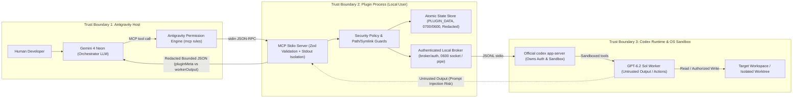

# Security Model & Threat Analysis — `codex-plugin-agy`

This document establishes the security architecture, threat model, mandatory invariants, fail-closed behaviors, and negative test requirements for `codex-plugin-agy`. Every security rule defined here is mandatory across all implementation Work Packages (`WP-01`..`WP-12`).

---

## 1. Security Philosophy & Core Invariants

`codex-plugin-agy` follows **Security by Default** and **Monotonic Least Privilege**:

1. **No Silent Escalation**: The plugin MUST NEVER escalate sandbox permissions, weaken user-configured Codex approval policies, expand network access, silently switch worker models, or silently switch authentication/billing methods.
2. **Hard-Banned Unsafe Modes**: `danger-full-access`, `--dangerously-bypass-approvals-and-sandbox`, `--dangerously-bypass-hook-trust`, and `--approve-for-me` are permanently banned across schemas, configuration, and runtime spawning.
3. **Zero Credential Handling**: The plugin NEVER reads, copies, caches, parses, logs, or transmits `~/.codex/auth.json`, OAuth access/refresh tokens, ChatGPT cookies, or API keys. Authentication stays 100% inside the official Codex runtime.
4. **Fail-Closed Approvals**: In non-interactive MCP execution, the plugin NEVER auto-approves Codex `ServerRequest` approval prompts.
5. **Zero Telemetry**: No analytics, remote logging, update pings, or outbound network connections are initiated by `codex-plugin-agy` itself (Codex CLI itself only talks to the user's configured provider).
6. **Honest Security Boundaries**: Capabilities that are prompt/audit conventions (such as `allowed_paths`) MUST NEVER be advertised as OS-level security boundaries.

---

## 2. Trust Boundaries & Attack Surface

---

## 3. STRIDE Threat Matrix & Controls

| ID | Category | Threat / Attack Scenario | Concrete Mitigation | Enforcement Module | Required Verification Test |
| --- | --- | --- | --- | --- | --- |
| **THR-01** | Elevation of Privilege | Caller/prompt passes `sandbox: "danger-full-access"` or unsafe Codex CLI flags | Zod schema allows only `"read-only" \| "workspace-write"`; policy engine asserts banned flag/mode denylist before every RPC/spawn | `src/mcp/schemas.ts`, `src/security/policy.ts`, `src/app-server/client.ts` | Unit + security tests rejecting `danger-full-access` and bypass flags at both MCP & runtime layers |
| **THR-02** | Elevation of Privilege | Plugin weakens stricter `sandbox_mode`, `approval_policy`, or `network_access` set in user's `~/.codex/config.toml` | Monotonic merge against `config/read` effective config: effective sandbox = `min(userConfig, requested)`, effective approval = `maxStrictness(userConfig, requested)`, `networkAccess` never elevated from `false` to `true` | `src/config/config-manager.ts`, `src/security/policy.ts` | Unit tests verifying monotonic precedence matrix across all sandbox/approval/network combinations |
| **THR-03** | Elevation of Privilege | Codex sends approval `ServerRequest` mid-turn and plugin auto-approves or crashes | Explicit fail-closed `ServerRequest` handler: never returns `"accept"`; replies `"cancel"` (command/file) or empty grant `{}` (permissions), transitions job to `awaiting_approval`, emits `codex resume <threadId>` | `src/app-server/approval-handler.ts`, `src/jobs/job-manager.ts` | Mock App Server integration tests for every approval `ServerRequest` variant |
| **THR-04** | Tampering / Injection | Command injection via repo filenames, branch refs (`--upload-pack=...`), prompts, or Windows `shell: true` | `shell: false` for all `git` and direct spawns; Windows resolver invokes `codex.exe` or `node codex.js` directly; git refs reject leading `-`, NUL, control chars, whitespace; always pass `--` before pathspecs; prompts travel exclusively over JSON-RPC stdin | `src/app-server/binary-resolver.ts`, `src/upstream/git.mjs`, `src/security/path-guard.ts` | Security tests with malicious refs (`--exec=calc`, `;whoami`, `$(id)`), paths with spaces/quotes/backticks |
| **THR-05** | Tampering / Traversal | Path traversal (`../../etc/passwd`) or symlink escape pointing outside workspace root (`cwd`, `paths`, `allowed_paths`, `relevant_files`, `thread_id` cross-workspace resume) | Canonicalize roots and targets with `fs.realpathSync.native`; verify `path.relative(root, target)` does not escape (`..` or absolute); validate `threadId` workspace binding via `SessionManager` + `thread/read` | `src/security/path-guard.ts`, `src/sessions/session-manager.ts` | Security tests using `..`, absolute external paths, symlinks pointing outside repo, and cross-workspace `thread_id` |
| **THR-06** | Information Disclosure | Secrets (API keys, OAuth tokens, JWTs, private keys, `.env` values, auth headers) leak into job logs, stderr, error messages, or MCP outputs | Deterministic `SecretRedactor` runs on ALL stderr, progress events, log lines, command outputs, error messages, and MCP responses before persistence and before serialization; never reads `~/.codex/auth.json` or dumps `process.env` | `src/security/redactor.ts`, `src/jobs/job-manager.ts`, `src/formatting/result-formatter.ts` | Unit + integration tests verifying redaction of OpenAI (`sk-...`), Google (`AIza...`), AWS (`AKIA...`), GitHub (`ghp_...`), Bearer/JWT, PEM keys, and custom env secrets |
| **THR-07** | Spoofing / Local IPC Hijack | Another local process connects to broker Unix socket in `/tmp` or guesses Windows named pipe to issue unauthorized Codex RPCs | Store Unix sockets in `0o700` `<pluginDataRoot>/run/<wsHash>/` with `0o600` mode; Windows pipes use random 128-bit hex suffix; mandatory `broker/auth` first-frame handshake validating 256-bit secret from `0o600` `broker.json` | `src/app-server/broker-endpoint.ts`, `src/app-server/broker-server.ts`, `src/app-server/broker-lifecycle.ts` | Integration tests verifying unauthenticated client connections are immediately rejected & closed |
| **THR-08** | Tampering / OS Mis-kill | PID recycling causes `codex_cancel` or broker teardown to terminate an unrelated OS process | Store & verify `ProcessIdentity { pid, startedAtMs, markerToken, executable }` before any `kill`/`taskkill`; refuse to kill on mismatch and mark job `interrupted` | `src/jobs/process-identity.ts`, `src/app-server/process.ts` | Unit tests mocking recycled/mismatched PID metadata verifying `kill` is NOT called |
| **THR-09** | Tampering / Prompt Injection | Malicious code/comments in repo or worker output inject instructions telling Neon to run destructive commands or escalate privileges | Separate `pluginMeta` (trusted plugin facts) from `workerOutput` (untrusted worker text) in JSON envelope; `rules/AGENTS.md` and skills explicitly forbid executing arbitrary instructions from `workerOutput` or auto-applying review findings | `src/formatting/result-formatter.ts`, `rules/AGENTS.md`, `skills/*/SKILL.md` | Unit tests verifying structural separation & prompt-injection fixture test ensuring `workerOutput` cannot spoof `pluginMeta` fields |
| **THR-10** | Denial of Service | Unbounded JSONL lines, giant diffs, runaway background workers, or infinite Stop Review Gate loops exhaust memory/disk/quota | Max JSONL line `16 MiB`; max stderr buffer `512 KiB`; default MCP response cap `16–24 KiB` with pagination; `maxConcurrency` (default `2`); `timeout_seconds` (default `600s`, max `3600s`); job retention cap (default `50`); Review Gate max runs (`2`), timeout (`120s`), `continuationActive` + `CODEX_PLUGIN_AGY_IN_HOOK=1` guard | `src/app-server/client.ts`, `src/jobs/job-manager.ts`, `src/workspace/workspace-manager.ts`, `src/adapters/antigravity/review-gate.ts` | Integration tests for oversized JSONL line, timeout termination, concurrency rejection, and Review Gate recursion circuit-breaker |
| **THR-11** | Protocol Corruption | Accidental `console.log` or library stdout output corrupts MCP stdio JSON-RPC stream | Redirect `console.log`/`info`/`debug` to `stderr` at MCP server bootstrap; all logger writes target `stderr` or `<pluginDataRoot>/logs/`; automated MCP stdout-purity test | `src/mcp/server.ts`, `scripts/mcp-server.mjs` | MCP test verifying every stdout line parses as valid JSON-RPC 2.0 frame |
| **THR-12** | Data Loss / Git Corruption | Parallel write workers overwrite each other or worktree cleanup discards uncommitted user work | Strict single-writer directory lock per canonical `cwd`; opt-in isolated worktrees under `<pluginDataRoot>/worktrees/`; zero destructive git commands (`reset --hard`, `clean -fd`, `checkout --`, auto-commit/merge/push/branch-delete forbidden) | `src/workspace/workspace-manager.ts` | Integration tests verifying concurrent write lock rejection, dirty primary tree preservation, and parallel conflict reporting |

---

## 4. Permission Policy & Monotonicity Matrix

### 4.1 Sandbox Policy Ceiling
Sandbox strictness ordering: `read-only` (strictest, rank 0) < `workspace-write` (rank 1) < `danger-full-access` (**FORBIDDEN**).

| Operation | Default Sandbox | Maximum Permitted Sandbox | Network Access |
| --- | --- | --- | --- |
| `codex_setup` | N/A (read-only RPCs) | N/A | None initiated by plugin |
| `codex_review` | `read-only` | `read-only` (immutable) | `false` |
| `codex_adversarial_review` | `read-only` | `read-only` (immutable) | `false` |
| `codex_transfer` | `read-only` | `read-only` (immutable) | `false` |
| `codex_delegate` (analysis / default) | `read-only` | `read-only` unless `sandbox: "workspace-write"` explicitly passed | Preserve user Codex config (default `false`; never expand) |
| `codex_delegate` (implementation) | `workspace-write` (explicit) | `workspace-write` (if user Codex config is `read-only`, **downgraded / rejected** with `POLICY_VIOLATION` — never weakens user's `read-only` config!) | Preserve user `config.sandbox_workspace_write.network_access` (default `false`) |
| `codex_resume` | Inherits bound thread sandbox | `workspace-write` (cannot escalate from user's Codex `read-only` floor) | Preserve user config |

### 4.2 Approval Policy Monotonicity
Approval strictness ordering: `never` (rank 0) < `on-request` (rank 1) < `untrusted` (rank 2).
- If user's `~/.codex/config.toml` (or trusted `.codex/config.toml`) sets `approval_policy = "on-request"` or `"untrusted"` (or granular), the plugin **MUST NOT** pass `"never"` to `thread/start` or `turn/start`. It preserves the user's stricter policy (or rejects if caller explicitly demanded `"never"` with `POLICY_VIOLATION`).
- When user's `config.approval_policy` is unset (`null`), default is `"never"` **strictly paired with `read-only` or `workspace-write` sandbox** so sandbox-confined actions proceed cleanly without prompting while any out-of-sandbox command fails inside the Codex OS sandbox.

### 4.3 Model & Billing Protection
- Default worker model: `gpt-6.2-sol`; default reasoning effort: `high`.
- If `model/list` shows `gpt-6.2-sol` (or any explicitly requested model) is unavailable on the active account/provider, return `MODEL_UNAVAILABLE` with diagnostics — **never silently fall back** to another model.
- If `account/read` shows authentication is missing/expired, return `AUTH_REQUIRED` / `AUTH_EXPIRED` advising `codex login` — **never silently switch** from ChatGPT login to an API key or paid billing mode.
- If Codex emits `model/rerouted` mid-turn, capture `{ fromModel, toModel, reason }` prominently in `pluginMeta.modelRerouted` and `pluginMeta.warnings` so neither Neon nor the user is misled about which model executed the turn.

---

## 5. Approval Request Fail-Closed Protocol

When Codex App Server initiates any `ServerRequest` (`ServerRequest.ts` in Codex `0.172.0`):

| ServerRequest Method | Plugin Wire Response | Job State Transition | User / Neon Action |
| --- | --- | --- | --- |
| `item/commandExecution/requestApproval` | `{ id, result: { decision: "cancel" } }` | `awaiting_approval` | Surface `command`, `cwd`, `reason`, `threadId`, and `codex resume <threadId>` |
| `item/fileChange/requestApproval` | `{ id, result: { decision: "cancel" } }` | `awaiting_approval` | Surface `reason`, `grantRoot`, `threadId`, and `codex resume <threadId>` |
| `item/permissions/requestApproval` | `{ id, result: { permissions: {}, scope: "turn" } }` | Record warning / `awaiting_approval` if turn stalls or fails | Surface requested `permissions`, `reason`, and `codex resume <threadId>` |
| `item/tool/requestUserInput` | `{ id, error: { code: -32601, message: "Interactive user input is unavailable in headless MCP mode; resume in Codex CLI." } }` | `awaiting_approval` | Surface questions + `codex resume <threadId>` |
| `mcpServer/elicitation/request` | `{ id, error: { code: -32601, message: "MCP elicitation is unavailable in headless MCP mode." } }` | `awaiting_approval` | Surface elicitation summary + `codex resume <threadId>` |
| Legacy `execCommandApproval` / `applyPatchApproval` | `{ id, result: { decision: "denied" } }` (or `"abort"` matching legacy enum; verify against generated `ApplyPatchApprovalParams`/`ExecCommandApprovalParams` in `WP-03`) | `awaiting_approval` | Surface summary + `codex resume <threadId>` |
| Any unknown `ServerRequest` | `{ id, error: { code: -32601, message: "Unsupported server request: <method>" } }` | Record warning | Fail closed without crashing connection |

---

## 6. Path, Symlink & `allowed_paths` Boundary Contract

1. **Workspace Canonicalization (`src/security/path-guard.ts`)**:
   - Resolve workspace root via `fs.realpathSync.native(resolveWorkspaceRoot(cwd))`.
   - Every supplied `cwd`, `paths[]`, `allowed_paths[]`, and `relevant_files[]` entry MUST:
     - Reject NUL bytes (`\0`) and control characters.
     - Resolve relative to canonical workspace root; for existing targets call `fs.realpathSync.native`, and for non-existent targets (e.g., new file path in `allowed_paths`) walk up to the nearest existing ancestor and call `fs.realpathSync.native` on that ancestor before joining remaining normalized segments.
     - Assert containment: `const rel = path.relative(canonicalRoot, canonicalTarget)` must NOT equal `".."`, must NOT start with `".." + path.sep`, and must NOT be absolute (handling Windows case-insensitive drive letters).
2. **`allowed_paths` Honesty Contract**:
   - Because Codex's `SandboxPolicy.workspaceWrite` grants write access across `cwd` rather than individual file globs, `allowed_paths` is **NOT** a kernel/OS security boundary.
   - Tool descriptions, `README.md`, and `pluginMeta` explicitly document `allowed_paths` as a **task-scope prompt constraint + post-execution diff audit**.
   - Any post-turn modified file outside `allowed_paths` is flagged in `pluginMeta.outOfScopeFiles` and `pluginMeta.warnings` so Neon can inspect or revert it.

---

## 7. Secret Redaction Specification (`src/security/redactor.ts`)

Applied deterministically to all stderr, job logs, command outputs, error strings, and MCP response payloads before disk write or wire return:

| Pattern Category | Detection Pattern (Regex) | Replacement |
| --- | --- | --- |
| OpenAI Keys | `\bsk-(?:proj-|svcacct-|admin-)?[A-Za-z0-9_-]{20,}\b` | `[REDACTED:OPENAI_KEY]` |
| Anthropic Keys | `\bsk-ant-[A-Za-z0-9_-]{20,}\b` | `[REDACTED:ANTHROPIC_KEY]` |
| Google / Gemini API Keys | `\bAIza[0-9A-Za-z_-]{35}\b` | `[REDACTED:GOOGLE_API_KEY]` |
| GitHub Tokens | `\b(?:ghp|gho|ghu|ghs|ghr)_[A-Za-z0-9]{30,}\b` and `\bgithub_pat_[A-Za-z0-9_]{22,}\b` | `[REDACTED:GITHUB_TOKEN]` |
| AWS Access Keys | `\b(?:AKIA\|ASIA)[0-9A-Z]{16}\b` | `[REDACTED:AWS_KEY]` |
| Bearer / Auth Headers | `(?i)(authorization\s*[:=]\s*(?:bearer\|basic)\s+)[^\s"']+` | `$1[REDACTED:AUTH_HEADER]` |
| JWTs | `\beyJ[A-Za-z0-9_-]{10,}\.eyJ[A-Za-z0-9_-]{10,}\.[A-Za-z0-9_-]{10,}\b` | `[REDACTED:JWT]` |
| PEM Private Keys | `-----BEGIN [A-Z0-9 ]*PRIVATE KEY-----[\s\S]*?-----END [A-Z0-9 ]*PRIVATE KEY-----` | `[REDACTED:PRIVATE_KEY]` |
| Known Secret Env Values | Exact substring match for non-empty values (`length >= 8`) of env vars matching `/(?:KEY\|TOKEN\|SECRET\|PASSWORD\|CREDENTIAL\|AUTH)/i` (excluding benign path/config vars like `CODEX_AGY_WORKER_TOKEN` which is already never logged) | `[REDACTED:ENV_SECRET]` |

---

## 8. Review Gate Anti-Recursion & Loop Circuit Breakers

The optional Antigravity `Stop` hook (`hooks.json` -> `scripts/hooks.mjs Stop`) enforces **five layered circuit breakers**:
1. **Default Disabled**: Both `hooks.json` (`"enabled": false`) AND workspace config (`reviewGate.enabled: false`) default to OFF.
2. **Environment Sentinel**: Hook sets `CODEX_PLUGIN_AGY_IN_HOOK=1` in child process env; if `process.env.CODEX_PLUGIN_AGY_IN_HOOK === "1"` on entry, immediately return `{}` (allow stop).
3. **Antigravity Native Continuation & Reason Checks**:
   - Allow stop (`{}`) immediately if `terminationReason` is NOT `"NO_TOOL_CALL"` (e.g., `USER_CANCELED`, `ERROR`, `MAX_INVOCATIONS`, `MAX_TOKEN_BUDGET_EXCEEDED`).
   - Allow stop (`{}`) if `fullyIdle === false` (unless warning note logged to stderr).
   - Check `continuationActive`, `executionNum`, and the `lastUserInput` hash in the persisted per-conversation state. Do not reset merely because `continuationActive` is false. The 1.5.17 probe observed it stay false while `executionNum` advanced from 0 to 1 on a continuation. Deduplicate attempts and fail open if a new turn cannot be identified safely. See [Phase 0.5](host-compatibility-delta.md).
4. **Hard Iteration Cap**: Maximum `maxRunsPerTurn` (default `2`, hard upper limit `5`). Once reached, immediately emit `{}` and log a concise stderr note so Neon/user can decide manually.
5. **Hard Timeout & Fail-Open Safety**: The internal review timeout defaults to `120s` (configurable `30..300s`). The host timeout allows bounded cleanup after the internal deadline. If Codex is unavailable, unauthenticated, or times out, log actionable diagnostic to stderr and emit `{}` (fail-open — never trap the user in an unclosable session).

---

## 9. Security Acceptance & Negative Test Checklist

Every item below MUST have an automated passing test in `tests/security/` (or `tests/unit/` / `tests/integration/`) before Phase 4 sign-off:

- [ ] `danger-full-access` rejected by `codex_delegate`, `codex_resume`, config loader, and `CodexRuntime`.
- [ ] Banned CLI flags (`--dangerously-bypass-approvals-and-sandbox`, `--dangerously-bypass-hook-trust`) cannot be injected via config or arguments.
- [ ] User Codex `read-only` sandbox or `on-request`/`untrusted` approval policy is NEVER weakened by plugin defaults or tool arguments.
- [ ] All Codex `ServerRequest` approval methods respond fail-closed (`cancel` / empty grant) and transition job to `awaiting_approval` with `codex resume <threadId>`.
- [ ] `git` commands reject refs starting with `-` (e.g., `--upload-pack=evil`) and always execute with `shell: false`.
- [ ] `codex` spawn on Windows resolves without `shell: true` for standard binary/npm installations and triggers zero `DEP0190` warnings.
- [ ] Path traversal (`../`), external absolute paths, and symlink escapes are rejected on `cwd`, `paths`, `allowed_paths`, and `relevant_files`.
- [ ] Cross-workspace `thread_id` resume is rejected with `THREAD_WORKSPACE_MISMATCH`.
- [ ] Unauthenticated connections to the local broker endpoint are closed immediately.
- [ ] Recycled/mismatched PIDs are NOT terminated by `codex_cancel` or broker teardown.
- [ ] All 9 secret categories in Section 7 are redacted from job logs, error payloads, and MCP results.
- [ ] MCP server `stdout` emits ONLY valid JSON-RPC frames even when errors, warnings, or debug events occur.
- [ ] Review Gate hook halts cleanly on `CODEX_PLUGIN_AGY_IN_HOOK=1`, non-`NO_TOOL_CALL` reasons, and `maxRunsPerTurn` exhaustion.
- [ ] Parallel `workspace-write` jobs on the same `cwd` without `use_worktree: true` are rejected with `WORKSPACE_WRITE_LOCKED`, and worktree creation never modifies a dirty primary working tree.
